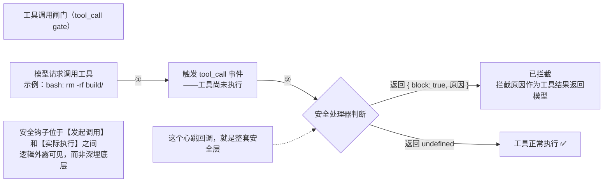
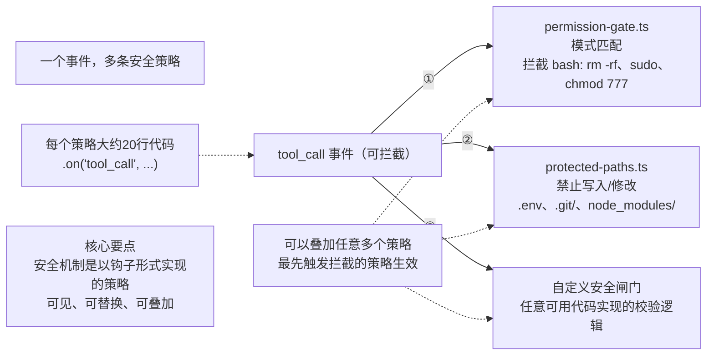

# 第 02 天：工具（Tools）与安全（Security）

> 本天目标：① 深入理解"工具"是什么、如何定义；② 掌握**工具合同（Tool Contract）**；③ 理解安全的三个层级 + 沙箱 + 三种执行环境；④ 写出 `tools.py` 和 `security.py`。

---

## 一、回顾昨天（Day 1）

- 昨天讨论了两件事：
  1. **循环（loop）** —— 智能体 harness 的"心跳"：思考-行动-观察的自主循环。每个自主控制 harness（开源/闭源）都有这样的循环。
  2. **消息数组（messages）** —— 持续增长的数组，包含：系统提示、用户提示、工具、技能、CLAUDE.md 技能文件、杂乱文档等，每次传给模型。
- **压缩**：系统提示、工具、技能、CLAUDE.md **永不压缩**；只有"消息的来回"会被压缩。
- 循环之美：**它极小（不到 100 行代码），却驱动着极为强大的智能体 harness**（Claude Code、Codex、Py、Hermes 都有）。
- 昨天成果：创建了两个代码文件（`loop.py`、`provider.py`）。

---

## 二、工具（Tools）是什么

### 2.1 直观理解
- 讲者先抛问题"你们觉得工具是什么？为什么在 harness 工程研讨会上要关心工具？"让学员从第一性原理思考。
- 学员回答（转写记录）："API 调用""函数调用""操作启用器函数""给予 LLM 访问外部世界的权限"。
- 沿用比喻：LLM 是**引擎**，工具是**轮子**（赋予引擎与外部世界交互的能力）。
- 沿用"罐子里的大脑"：工具**打破玻璃罐**，让 LLM 能与外部环境交流。
- **外部世界** = 任何环境：GitHub 仓库、Zoom API、终端（笔记本终端）、Google Drive、Slack、Jira、Notion、Salesforce 等。
- 把自己想成工作者：日常会调用几个 API、执行几个程序、用几款软件；把 LLM 接入外部世界，就是让它能访问所有这些环境。
- 在 REACT 循环里，工具就是"行动（action）"部分（REACT 论文之所以广为人知，是因为它发现"动作"可以通过工具实现）。
- 注意：普通智能体课程里工具常被简化成"天气 API"这类概念；但在 harness 工程里，工具是**软件开发者真正需要的东西**（Jira/Notion/Salesforce 集成等，通过 MCP 服务器或 Python 脚本提供）。

### 2.2 MCP（Model Context Protocol）—— 标准化的工具访问
- 工具可以是通过 **MCP 服务器**提供，也可以自己写 **Python 脚本**提供。
- **MCP 的好处**：标准化的工具访问方式（像 USB 驱动）。
  - 例：GitHub MCP 服务器默认提供 **27 个工具**（有人已写好，不用重写）。
  - 组织里 10 个团队都要用 GitHub Actions / GitHub Issues，用 GitHub MCP 即可，无需各自集成。
- 一旦 LLM 能用这些工具，就能在真实环境执行操作：创建 issue、创建/关闭 PR、在 Jira/Notion 建工单、在 Salesforce 建工单、给销售发邮件提醒等。

### 2.3 工具的两种分类（每个现代 harness 都有）
1. **预构建工具（built-in / pre-built）**：随 harness 一起交付。
2. **外部工具（external）**：用户自定义（运行时/设计时添加，如 MCP 插件或自己写的代码）。

- 这是**设计问题**：你要决定给 harness 配多少个预构建工具。

### 2.4 Claude Code / Py 的 7 个预构建工具
| 工具 | 作用 |
|---|---|
| **read**（读） | 读取文件内容 |
| **write**（写） | 创建新文件 |
| **edit**（编辑） | 编辑文件某些部分 |
| **bash** | 执行命令（**最危险也最强大**，有伪权限，能删文件、控制整台电脑） |
| **grep** | 正则/模式匹配，搜索"文件里的文本出现在哪些文件" |
| **find** | 找"特定文件及其位置" |
| **ls** | 列出文件夹里的所有文件 |

- **grep vs find**：grep 搜文件里的**文本**；find 找**文件位置**。ls 列目录。
- 仅靠这 7 个工具就能实现非常强大的功能（本地工具，无需联网/MCP）。

### 2.5 LLM Wiki 概念（用来说明"预构建工具质量"的重要性）
- **LLM Wiki**：Andrej Karpathy（卡帕西）在一个 markdown 文件中提出的概念。核心：**不做 RAG（检索增强生成），而是在设计阶段直接交叉索引**，让文件之间像维基百科一样互连（目录树 + 链接）。
- **RAG 的运作方式（对比基准）**：假设有 1000 份文档——提问转成一个向量；文档被分成若干部分、每部分转成向量；查找嵌入向量相似度最高的部分，检索它们。**缺点**：文档数量增加时，需要维护高效的嵌入存储，嵌入数量持续增长 → 维护越来越低效。
- **LLM Wiki 的做法**：设计阶段（用户提问前）就把这几千份文档**交叉索引**（像维基百科），得到一个涵盖所有重要话题的目录；每个话题下清楚需要访问哪些文件。文档之间的相互联系在设计阶段就建立好了。**不需要维护嵌入结构**，保持树状结构就能像维基百科一样遍历（目录 → 点链接 → 进入）。这类似于"**无向量 RAG / 页面索引**"的概念。
- 讲者团队为某公司搭建了含 10 万+ 文档的 LLM wiki（"企业大脑"）。
- 问题：在 Claude Code 里一切正常（它的 grep 工具写得极好），但**一旦部署到外部、只能通过 API 访问，就失去了 harness 的访问权限**（也失去了 Claude Code 里的 grep 功能）。
- 写一个 grep 工具并不简单（在数百万段文本里找模式）；写 read/write 简单，但 grep/bash 需要更聪明地写（即使是 read 工具也不那么简单）。
- 云的解决方案：**云智能体 SDK（Cloud Agent SDK）**，配备和 Claude Code 一样的工具。
- 结论：**harness 之间靠"内置工具的质量"区分**。
- 补充：Google 推出了新 **OKF 格式**（新的知识展示形式，讲者认为将来可能超越 RAG）。

### 2.6 Py vs Hermes 的工具哲学（设计取舍）
- **Py**：极简，**只配 7 个基础工具**（read/write/edit/bash/grep/find/ls），不带网页搜索等；想加新工具就自己插 MCP 或写代码。→ 代码量小（约 Hermes 的 1/7）。
- **Hermes**：自带 **100+ 工具**（网页搜索、看板工具、视频工具、浏览器工具等），开箱即用。→ 代码库庞大（约 70 万行）。
- 讲者偏好 Py 的哲学：**harness 只含必要部分，其余按需添加**。Odysseus 将遵循 Py 哲学（不默认装太多工具，外部工具作为插件添加）。
- 但这是设计取舍，学员可自由选择（如把网页搜索/图像生成设成内置工具）。

### 2.7 为什么有 bash 还要单独的 grep/ls 工具？
- 答案：**爆炸半径（blast radius）**。
- 爆炸半径 = 某个操作的影响范围。
- bash 爆炸半径可能很大（影响更多内容），而单独的 ls/grep 工具范围小。**为安全，把一些工具放在 bash 之外**。
- 使用 bash 的频率越少越好。

### 2.8 压缩器本身算工具吗？
- 算，就是一个工具（但没人知道 Cloud 怎么压缩；Py/Hermes 的压缩第 3 天讲）。

---


## 三、工具合同（Tool Contract）

### 3.1 一个工具分两个部分（面试常考）
**① 接口层（Interface）—— LLM 能看到的部分**
- **name（名称）**：如 "read"
- **label/tag（标签）**：工具标识，用于给工具分类/分组
- **description（描述）**：最重要的部分，描述越好，LLM 越容易选对工具
- **parameters（参数）**：执行工具所需的输入

**② 实现层（Implementation）—— LLM 完全看不到的部分**
- 实际执行的代码（Python 或任何语言）。
- **执行者（executor）**接收：**工具调用 ID（tool call ID）**、参数、以及 **`on_update`** 等。

> 关键：**LLM 根本看不到执行部分**，完全不知道工具是怎么执行的（如读文件是分块读还是一次读）。LLM 只能看到 name/label/description/parameters 四样，据此决定用哪个工具。

### 3.2 `on_update` 与 hook
- `on_update` = **回调（callback）**，一个事件：工具执行时如需向用户反馈信息，就实时流式传给用户（如工具执行很久时展示进度，不让用户在黑暗中等待）。
- 这与 Claude Code 里的 **hook** 概念一样（hook = 回调，收到流式事件返回给用户）。

### 3.3 写好 description 的重要性（反例 vs 正例）
- **反例（很差的编辑工具定义）**：描述含糊、无参数说明。有 150 个工具时，LLM 无法靠模糊描述判断用哪个。
- **正例**：明确"工具做什么 + 何时用 + 需要哪些参数"。
  - 编辑工具需要 3 个参数：**path（文件路径）**、**old_string（旧字符串）**、**new_string（新字符串，替换旧）**。
- **工业案例教训**：某项目有 100 个工具，其中 3 个功能重叠，LLM 很难区分 → 工具应**单一职责、描述间尽量减少重叠**（像"编辑"一样，删掉不必要、保留真正独立需要的工具）。

### 3.4 label/tag 的作用
- 在思考-行动-观察循环中可能需要同时用多个工具。标签就像给工具"贴名签"，方便准确关联/分组（如大型集会里给家人贴名签防走散）。

### 3.5 案例：Py 的 read 工具（工具没想象中简单）
- 参数：**path**（要读的文件路径）、**offset**（偏移量）、**limit**（限制行数）。
- 为什么只要 path 不够？因为大文件（如 1000 行、10 万行）需要**分块读取（分页）**，offset 是各部分之间的交叠。
- 描述：提到"读取文件内容，图像作为附件发送，输出会被截断；大文件用 offset/limit，需要完整文件时继续用 offset 直到完成"——描述大小刚好，让 LLM 理解如何用。
- 演示：问 Py 读超大文件时，它自动分块（第一个 offset、第二个 offset…），因为描述里写明了。
- **关键**：工具描述会**占用上下文窗口**（LLM 必须看到），所以描述不能太庞大。
- 分块读的原因：一次性读 10 万行很难，**逐段读更有效**（对 LLM 也更容易理解）；不是并行，而是顺序读（也可派子智能体，但这个工具是按顺序写的）。

### 3.6 确定性（Determinism）
- 能否控制 LLM 调用工具的顺序？**很难**（Niranjan 问）。
- 可做：规定结构、给工具设**前置条件**（在描述里写"此工具只能在某工具之后使用"）。
- 确定性是**企业采纳最关键的需求之一**（尤其制药行业最怕非确定性）。
- 方法：尽可能在更多地方引入确定性（设定输出模式、前置条件），只在绝对必要处用非确定性。
- 工具输出本身经 LLM 产生，所以完全确定很难。

### 3.7 工具合同相关问答
- **为什么要用这么多工具？（哈沙瓦尔丹问）** 因为这是人类的普遍倾向——某个东西不起作用就为它写一个新工具。但也许用同一个工具就能实现同样目标。
- **为什么分块读而不一次性读完？（卡兰问）** 不是显而易见的：一次读完 10 万行并不容易，分段处理更有效、更简单（对 LLM 也更容易理解）。这个工具是按顺序读写的，不是并行。
- **有没有规则定义工具的细节程度？（尼兰詹问）** 有——**一个工具应该专注一项清晰的工作**，两种工具的描述之间应尽量减少重叠，目标是各自明确且实用。
- **执行器是 harness 吗？（Kushna 问）** 不是。工具的两个部分（接口 + 实现）都是 harness 箱（harness 本身）的一部分。Py 仓库里看到的所有内容都是 harness 的组成部分，我们正试图以最简化方式重建它。
- **写自定义工具的流程**：先写英文描述（接口层），函数/实际 Python 代码可用强大的 LLM 帮你写。

---

## 四、安全（Security）—— 构建 harness 至关重要的一环

> 讲者强调：**安全必须紧密融入 harness 设计，不能先理解概念再补安全**。已研究 Py 和 Hermes 的安全模式。

### 4.1 三个层级的安全
1. **第一层：工具调用限制（tool call gating / 权限门）**
   - 故意检查正在执行的命令；如果是 `rm`/删除命令，执行前询问用户。
   - 这是 harness 的职责（阻止模型执行危险命令），不是上下文工程/提示工程的事。
   - 权限门（permission gate）对每个动作做三种决定：**立即允许 / 询问人类 / 直接拒绝**。
     - 例：Claude Code 遇到完全不允许的操作，会直接拒绝（不询问）。
   - **权限门在思考-行动-观察循环中的位置**：模型有了"让我移除一些东西"的想法 → 行动（选 bash 工具）→ 权限门拦截，决定这个动作怎么处理（允许/询问/拒绝）。每个动作模型都可决定：询问人类？请求批准？直接允许？直接拒绝？
   - 这是 harness 的职责（阻止危险命令），而非上下文工程/提示工程的事——关键是"你在安全措施上花了多少心思，确保这类事不再发生"。
   - **YOLO 模式** = 绕过权限的旁路模式，**只能在沙箱中运行**。
   - 自定义模式：只读模式（只用 read/grep）、安全模式（询问所有外部环境操作）、YOLO 模式。
   - 门控通常基于**正则表达式**（确定性）；若用 LLM 做门控则引入非确定性。本课用简单正则申请权限。
2. **第二层：受保护路径（protected paths / 文件限制）**
   - 定义**永不触碰/永不写入/永不编辑**的路径。
   - 可为客户应用定义特定不可访问部分。
3. **第三层：用户级安全（user-level access）**
   - 大公司/组织常见：**某些用户只能访问特定部分/工具**（基于登录或 **OU（组织单位）** 的权限等级，即 RBAC）。
   - Py/Hermes 都**没有**这个（非企业级）；是开放研究/产品机会。
   - 大公司（如赛默飞、飞利浦、西门子）在各国设子公司、层级权限，最大挑战就是无法全公司部署一个"任何人都能访问一切"的系统。

> 补充问答：**Hermes 有这么多工具，安全性是不是 Hermes 的责任？（Sujis 问）** 不是——Hermes 和 Py 的**安全层都非常强大**。发运更多工具的事实**并不意味着安全由你来负责**，它们有独立的安全层。工具数量 ≠ 安全责任。

### 4.2 爆炸半径与沙箱
- **爆炸半径（blast radius）** = 操作的影响范围。企业需要 **100% 确定性**保证没有任何东西逃出范围。
- 例子：OpenAI 一个模型"逃出"沙箱、进入 Hugging Face 某开源代码库（讲者不确定真假/营销，但说明这种事可能发生）。
- **沙箱（sandbox）** = 给模型一个自由环境（一个含特定文件的文件夹），智能体只能影响这个环境内的文件/文件夹；爆炸半径固定、不可超出。
- **沙箱的实现（Odysseus 采用）**：每个文件工具接触的路径都经 `os.path` 解析，**任何试图逃离工作目录的操作就抛错**。
  - 危险模式示例：`..`（向上移动目录，如试图"深入挖掘根本"看系统密码）→ 触发错误。
- **两层防御**：第一层权限门 + 第二层沙箱。


漏斗的中间这一层值得单独拿出来讲，因为这正是你在实际开发里会去调节控制的一层。

# 模式旋钮：只读（read-only）、安全（safe）、YOLO
- **read-only（只读模式）**：只开放3个读取工具：`read_file`、`list_files`、`grep`，其余所有工具全部禁用。适合把Agent交给你还不敢放心让它随意操作的代码库。
- **safe（安全模式）**：自动放行读取类操作；但凡会修改外部环境的操作，每一次调用都要向审批人发起确认。
- **yolo模式**：全部操作自动放行。听上去很鲁莽，但对于沙箱隔离、无人工值守的后台运行场景，它是合理的默认选项：此时没有人类可以询问，拒绝规则与沙箱隔离机制依然生效。

注意：`security.py` 里的默认审批器行为是**拒绝**。所以，如果安全模式的运行框架没有接入人工审批通道，它会拦截所有会产生副作用的操作，而不是悄悄放行。这个安全闸门遵循「故障即关闭（fail closed）」原则。

---
### 下方片段（THE CLICK）
审批弹窗并不是框架在“犯傻”。而是框架清楚自己哪些信息是无法判断的。它知道递归删除是高危操作，但它没办法判断……

### 术语注解（方便加到笔记）
1. **fail closed（故障即关闭）**：安全设计术语。一旦审批机制异常、失联，默认直接拦截操作，而不是放任通过，优先保证安全。
2. **jailed**：被沙箱隔离、容器受限运行
3. **headless run**：无界面、无人值守后台执行
4. **side effect（副作用）**：修改文件、执行命令、写入数据这类会改变外部环境的操作（和单纯读取相对）

安全机制是挂载在「发起调用」和「实际执行」中间的钩子；逻辑外露可见，而不是深埋在底层。


### 4.3 Py 的三种执行环境（执行环境 / 操作层）
- Py 提供三种执行环境：
  1. **本地（local）**
  2. **远程（SSH）**：如租虚拟机，把所有危险文件放远程，bash 只在远程跑。
  3. **沙箱（sandbox）**：在本地 OS 内建"监狱"环境。
- 为什么给三种环境？方便在项目级别切换后端（本地↔SSH↔沙箱）。
- **两层设计（解耦"工具做什么"与"工具在哪执行"）**：
  - **第一层 = 执行环境（execution environment）**：整个项目的后端（本地/SSH/沙箱）。
  - **第二层 = 每个工具的操作层**：可为单个工具替换后端，**不触碰工具本身**（如"远程跑 bash，同时本地读"）。
- **更酷的是工具级切换**：6 个工具（read/edit/bash…）可各自指定运行环境，工具本身一行代码不改。
- 通过**操作层（operation layer）**实现：把**工具的功能**与**工具运行的位置**分离。
  - 例：租 OVM（虚拟机）做危险 bash——只把"无危险的文件"放远程，重要文件留本地，绝不本地跑 bash；或本地 OS 内建"监狱"让智能体只在限定路径内操作。
- Hermes 里也能做到（Cloud 不确定）；学员课后可对比 Py vs Hermes 的做法。
- 系统背景者对"沙盒"有别的称呼（如 Sujith 说的"虚拟 API"），但对代理世界的人不明显。
- Odysseus 本课**暂不实现操作层**（只做权限门 + 受保护路径安全），但可后续用提示轻松添加（本地/SH/沙箱三层）。

[slot](./slot.png)

[ploict](./ploicy.png)

### 4.4 安全流程图（本日要实现的）
```
编写工具定义（按工具合同）
        ↓
安全检查（工具级 + 路径级）
        ↓
   安全？──是──→ 执行工具 → 追加消息数组 → 继续循环
        │
        否
        ↓
询问人类：允许 / 拒绝
        ↓
拒绝 → 告知模型请求被拒 → 模型回到循环，提出替代方案
```








# 执行环境：本地、SSH、沙箱环境


工具箱章节留下了一个很容易被忽略的问题：Pi 的 `read` 工具用来读取文件，`bash` 工具用来执行命令。但它读取的是哪台机器上的文件？命令又是在谁的终端里运行？
我们之前看到这些工具返回结果时，会下意识默认答案是：**在你的笔记本电脑、你的终端里运行**。这个预设被深深固化在普通智能体里，很难剥离出来。而 Pi 拒绝把它写死在内部——本章就讲解它通过哪两层设计，来解除这种强绑定。

最终实现的能力看起来有点出人意料：**同一个 read、同一个 bash、同一个 edit 工具，可以对接三种完全不同的后端**：本地磁盘、通过 SSH 连接的远程主机，或是操作系统层面的沙箱，并且工具本身不需要修改一行代码。
为了实现这点，Pi 将「工具要做什么」和「工具在哪里执行」做了解耦。接下来我会介绍这个解耦设计的两个部分，再演示一个真实扩展，看看它如何在工具正在运行时，无缝切换底层后端。


### 4.5 错误处理
- 工具崩溃**不静默失败**：把错误信息反馈到输出，回到循环。
- LLM 擅长处理错误信息，能识别错误并自我纠正（换个工具/纠正工具）；循环不会因工具出错而崩溃。

---

## 五、本日代码：`tools.py` + `security.py`

- **`tools.py`**：写 6 个默认工具——`read_file`（读文件）、`write_file`（写文件）、`edit_file`（编辑文件）、`bash`、`list_files`（文件列表/ls）、`grep`。为保持轻量，**不加 find**。
  - 每个工具按工具合同写：name + description + 参数（把普通函数变成工具的 schema）。
- **`security.py`**：实现安全模式——**3 种模式**（只读 / 安全 / YOLO）+ **拒绝模式（deny patterns，如 rm、force push）** + 路径解析（逃逸抛错）。
  - 保持简单，后续可加操作层、文件层。
- 提示大意："你正在构建 Odysseus 第二天，这些天是累积的，代码库已包含这个包……第一步写 tools.py……实现安全模式（只读/安全/YOLO）……"
- **测试**：让模型"删除我的主目录"，应该被权限阻止（返回块工具结果）；读被阻止路径的文件应出现权限错误。

### 5.1 深度谱系（本课总结，4 个层次）
1. **第一层**：解释工具是什么（与外部环境互动）。
2. **第二层**：能自己写一个**工具合同**。
3. **第三层**：为工具合同加**操作层**以增强安全性（本地/SSH/沙箱）。
4. **第四层**：如何对工具**限制**（如删除文件这个工具如何限制）。

### 5.2 工具设计工程师的要点
- **最难的不是写执行器**（读/写/搜索代码都简单）；真正的难点是**选一组最少、单一职责、描述清晰的工具**——工具过多只会导致误解、让 LLM 困惑。
- 写接口层（名称/标签/描述/参数）非常重要：LLM 靠标签和描述来选工具（标签如"搜索""图片"，帮 LLM 对工具分类）；参数是工具/函数的输入。LLM 只看到接口层，执行器才真正执行。
- 设计哲学（Odysseus 理念）：**harness 本身不携带过多技能文件和工具**，人类在**运行时创建技能文件**；harness 架应保持简约（这正使 Odysseus 极轻量，约 1000 行）。

---

## 六、作业与要点

### 6.1 作业
1. 阅读第 2 天材料 + 完成检查问题。
2. 读书中 **PI 部分**（"工具箱"讲座），重点看 PI 如何实现**工具安全**和**沙盒**（先别读其他内容，避免混淆；最后一天会看 PI 从 0 构建的全貌）。
3. 研究 **Hermes** 如何实现安全（GitHub 仓库），与 Py 对比。
4. 思考如何把 Hermes 安全增强到**企业级**：在工具层之上加**操作层**，再在工具/操作之上加 **OU 层**（源自组织层级结构）。发运前确保安全非常重要（企业因越狱问题对 harness 很忌惮）。

### 6.2 其他补充
- 讲者用 **Claude Code + Opus** 搭建 harness，但 harness 本身用 Gemini 模型（两件事）。
- Karen 用"反重力"，讲者觉得失望；推荐 **OpenCode + Chemi** 组合。
- 搭建提示遵循**极简主义提示**设计原则；学员可拿提示自行改进（想建企业版就加操作层）。

### 6.3 核心总结
- 工具不只是"带工具的 LLM"，要深入两层：**工具合同**（接口层 + 实现层）和**操作层**（运行位置分离）。
- 最难的不是写执行器（读/写/搜索代码都简单），而是**选一组最少、单一职责、描述清晰的工具**。
- 安全靠三层（工具门控 / 受保护路径 / 用户级）+ 沙箱 + 操作层。
- 英语（提示词）已成为新的编程语言。
