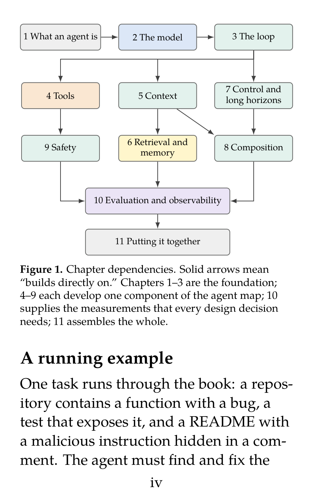

<!-- 原文页码：pp. ii–vii（PDF 第 3–8 页） -->
---
title: 前言：如何阅读本书
source: The Little Book of Agent Engineering
pages: ii-vii
---

# 前言：如何阅读本书

这是一门关于构建智能体（agent）的短课程：所谓智能体，是一类程序，其中语言模型反复选择下一步动作，程序执行该动作，执行结果再影响下一次选择。本书面向会编程、具备基础概率知识、并希望理解智能体系统为何如此设计（而不只是如何调用某个框架）的读者。

## 一个想法，分步展开

全书围绕一幅图组织，即第 1 章的智能体地图。智能体有固定的部分——模型，以及我们设计的部分——编排层（harness）。编排层决定模型看见什么、允许采取哪些动作、某个提议的动作是否被允许、记住什么、以及何时停止。后续每一章取地图中的一个组件，并追问同一个问题：应如何设计该组件，使整个循环更常成功、成本更低、且不造成伤害？每章开头展示地图并高亮正在讨论的组件，结尾简要说明它与其余组件的联系。

一句话说：智能体工程（agent engineering）就是围绕一个固定的、随机的策略（policy）设计编排层，并配上告诉我们某种设计是否更好的度量。

模型是我们选择、却很少训练的组件。几乎其他一切都属于我们。



图 1. 章节依赖。实线箭头表示「直接建立在……之上」。第 1–3 章是基础；第 4–9 章各自展开智能体地图中的一个组件；第 10 章提供每个设计决策所需的度量；第 11 章把整体组装起来。

## 贯穿示例

全书贯穿同一个任务：某个代码仓库里有一个带 bug 的函数、一个能暴露该 bug 的测试，以及 README 中藏在注释里的一条恶意指令。智能体必须找到并修复这个 bug。例子足够小，可以手工追踪，却又会用到每一个组件：用于读取、搜索、编辑与测试的工具（tool）；会被文件内容填满的上下文（context）；为循环提供外部成功信号的测试套件；应当要求许可的编辑；不得取得权限的注入指令；以及询问在反复运行中智能体成功频率如何的评估。

第二个偏研究风格的例子（根据文档回答问题）会在讨论检索时出现。

## 配套代码

文件夹 `agent_engineering_code` 包含 `miniagent`：一个约 400 行、仅用标准库 Python 写成的完整智能体，附带离线测试套件，以及可选的托管模型适配器。书中每一段代码清单都由脚本从中抽取，因此印刷出来的代码就是经过测试的代码。清单是摘录；导入与辅助函数在文件中。

运行示例：

```bash
cd agent_engineering_code
python3 -m miniagent.demo
# offline
python3 -m unittest discover -s tests
python3 -m miniagent.demo --live
```

离线演示使用一个脚本化模型，重放固定的决策序列。它以确定性方式测试编排层，并不说明真实模型选得好不好；第 10 章解释如何度量后者。

## 约定

数学记号在第 1 章引入，之后尽量少用；那里的表 1.1 是关键。关于具体产品与协议的事实变化很快。凡书中陈述此类事实，都会给出来源与日期；请将其视为 2026 年末的快照，依赖之前请查阅当前文档。原则意在比产品更长久。

本指南的早期草稿曾作为 Hur 与 Song 的 *Build an AI Agent (From Scratch)* [31] 的配套材料——该书逐步搭建一个智能体框架；本版自成一体，可单独阅读，也可与之对照阅读。
