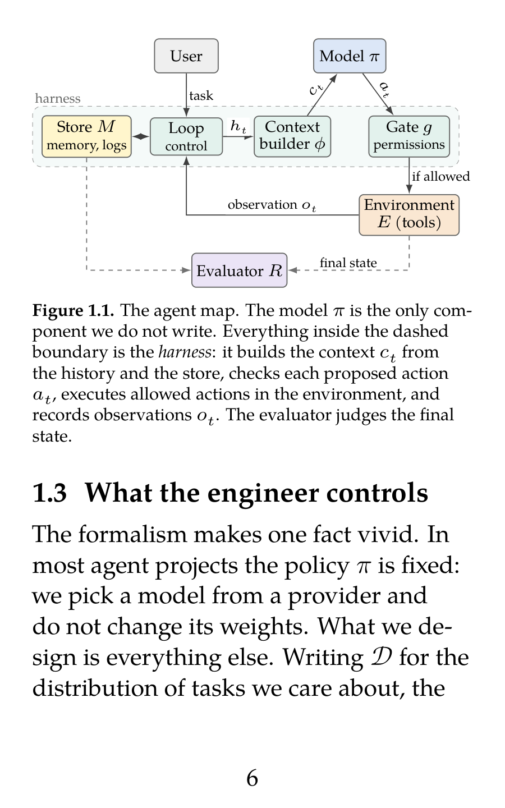
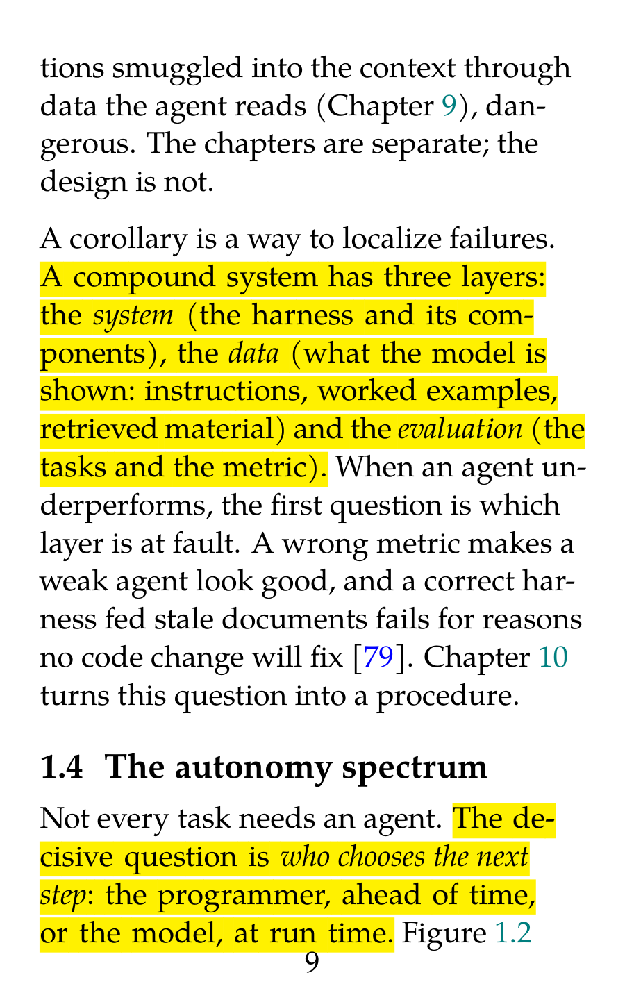
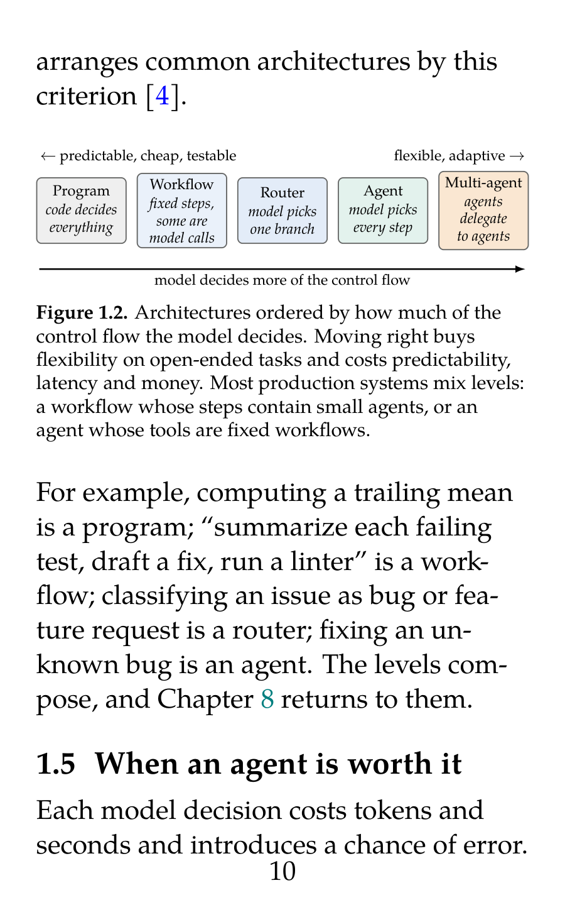
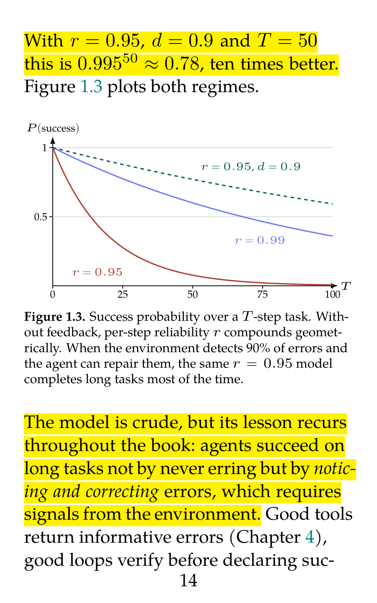

<!-- 原文页码：pp. 1–17（PDF 第 9–25 页） -->
---
title: 第 1 章 什么是智能体
source: The Little Book of Agent Engineering
pages: 1-17
---

# 第 1 章 什么是智能体

**我们在哪里。** 本章介绍整幅地图；箭头上的符号在第 1.2 节定义。后续章节每次放大其中一个组件。

## 1.1 从一次函数调用到一个循环

考虑我们的贯穿示例。一个小仓库里有 `stats.py`，其中定义了函数 `trailing_mean(xs, w)`：在每个位置 $i$，它应返回以 $i$ 结尾、长度为 $w$ 的最近一段均值。有一个测试断言 `trailing_mean([10,20,30,40], 2)` 等于 `[10,15,25,35]`。测试失败了。我们希望有一个程序：只给定指令「测试失败了；找到 bug 并修好」，就能产出正确的编辑。

一般而言，没有固定脚本能做到这一点，因为有用的下一步取决于目前已经学到了什么：失败信息提示某个文件，文件引出一个假设，假设引出一次编辑，再跑测试则确认或推翻假设。语言模型可以在这个「行动—观察—决定」的循环中扮演决策角色：它提议下一步操作，周围的程序执行它并把结果反馈回来。

> **智能体（agent）** 是这样一种程序：模型反复选择动作，程序在环境中执行这些动作，观察结果影响后续选择，直到模型声明任务完成或达到某个限制。

该定义排除了单次模型调用（没有循环）以及固定流水线式的多次调用（模型不选择下一步）。它把「感知并作用于环境」这一经典智能体概念 [60] 特化到通过文本与结构化数据行动的语言模型上 [73, 71]。

## 1.2 智能体循环，形式化表述

本书中的每一个设计决策都关乎下列循环中的某一项，因此值得精确陈述。令 $u$ 为用户的任务。在每一步 $i$，模型提议一个动作 $a_i$（一次工具调用，或决定停止），编排层（harness）返回一个观察 $o_i$（工具的输出，或一次拒绝）。经过 $t-1$ 步之后，历史是迄今发生的一切的序列：

$$
h_t = (u, a_1, o_1, a_2, o_2, \ldots, a_{t-1}, o_{t-1}).
$$

模型从不直接看见 $h_t$。编排层从历史以及任意外部存储 $M$（文件、记忆、文档）构建上下文（context）：

$$
c_t = \phi(h_t, M), \qquad |c_t| \le W,
$$

其中 $|c_t|$ 是以 token 计的长度（模型读写文本的单位；一个英文 token 大约相当于四分之三个词），$W$ 是模型的上下文窗口。模型是一个随机策略（policy）：它把上下文映射为动作上的分布，再从中采样一个动作，

$$
a_t \sim \pi(\cdot \mid c_t), \qquad a_t \in \mathcal{A} \cup \{\mathrm{stop}(y)\}.
$$

这里 $\mathcal{A}$ 是编排层提供的工具调用集合，$\mathrm{stop}(y)$ 表示「以答案 $y$ 结束」。提议的动作不会被盲目执行。门控（gate）$g$ 决定它在环境当前状态 $s_t$ 下是否可以运行：

$$
o_t =
\begin{cases}
E(s_t, a_t) & \text{若 } g(a_t, s_t) = \mathrm{allow}, \\
\text{拒绝消息（如「不允许：……」）} & \text{否则}.
\end{cases}
$$

被允许的动作还可能改变环境状态，$s_t \mapsto s_{t+1}$。运行在停止时刻结束：

$$
\tau = \min\{t : a_t = \mathrm{stop}(y)\} \wedge T_{\max},
$$

其中 $T_{\max}$ 是预算。最后，评估器 $R$ 根据最终状态与答案评判结果，最简单的情形是 $R(s_\tau, y) \in \{0, 1\}$。

图 1.1. 智能体地图。模型 $\pi$ 是我们唯一不编写的组件。虚线边界内的一切都是编排层：它从历史与存储构建上下文 $c_t$，检查每个提议的动作 $a_t$，在环境中执行被允许的动作，并记录观察 $o_t$。评估器评判最终状态。

## 1.3 工程师控制什么

形式化让一件事实变得鲜明。在大多数智能体项目中，策略 $\pi$ 是固定的：我们从某个提供商挑选模型，并不改变其权重。我们设计的是其他一切。用 $\mathcal{D}$ 表示我们关心的任务分布，工程问题大致是

$$
\max_{\mathcal{A},\, \phi,\, g,\, M,\, \mathrm{loop}}
\mathbb{E}_{u \sim \mathcal{D}} \mathbb{E}_{\pi}[R(s_\tau, y)]
- \lambda \mathbb{E}[\mathrm{cost}]
\quad \text{s.t. 安全约束},
$$

其中内层期望取自模型的随机性，$\lambda$ 为 token 与时间定价。这不同于强化学习——在那里被优化的是策略本身。这里我们优化的是策略的周围环境。表 1.1 列出各个杠杆以及展开它们的章节；它是本书的脊梁。

表 1.1. 智能体的各个组件、各自引出的设计问题，以及在何处讨论。

| 符号 | 设计问题 | 章节 |
|------|----------|------|
| $\pi$ | 选哪个模型，以及如何与它对话？ | 2 |
| loop，$\tau$ | 步骤如何排序与停止？ | 3, 7 |
| $\mathcal{A}$，$E$ | 存在哪些动作，它们返回什么？ | 4 |
| $\phi$，$W$ | 每一步模型看见什么？ | 5 |
| $M$ | 窗口之外存了什么，如何找到？ | 6 |
| 循环结构 | 一个智能体、一个工作流，还是多个智能体？ | 8 |
| $g$ | 哪些动作可以运行，由谁决定？ | 9 |
| $R$ | 我们如何知道一次改动有帮助？ | 10 |

由此得出两点后果。因为 $\pi$ 是随机的，一次运行是一个随机变量，关于智能体质量的每一条论断都是统计论断（第 10 章）。并且各组件相互作用：返回巨大输出的工具（关于 $\mathcal{A}$ 的选择）会损害上下文（$\phi$）；过于宽松的门控使提示注入（prompt injection）——通过智能体读取的数据、走私进上下文的指令（第 9 章）——变得危险。章节是分开的；设计却不是。

一个推论是如何定位故障。复合系统有三层：系统（编排层及其组件）、数据（展示给模型的内容：指令、范例、检索材料）以及评估（任务与指标）。当智能体表现不佳时，第一个问题是哪一层出了问题。错误的指标会让弱智能体看起来很好；正确的编排层喂进过时文档也会失败，而且原因不是改代码能修好的 [79]。第 10 章把这个问题变成一套程序。

## 1.4 自主性光谱

并非每个任务都需要智能体。决定性的问题是：谁选择下一步——程序员事先决定，还是模型在运行时决定。图 1.2 按这一准则排列常见架构 [4]。

图 1.2. 按模型决定控制流多少排序的架构。向右移动换取开放式任务上的灵活性，代价是可预测性、延迟与金钱。大多数生产系统混合各级：工作流的步骤中嵌入小型智能体，或智能体的工具是固定工作流。

例如，计算 trailing mean 是一个程序；「总结每个失败测试、起草修复、跑 linter」是一个工作流；把问题分类为 bug 或功能请求是一个路由器；修复未知 bug 是一个智能体。各级可以组合，第 8 章会再谈。

## 1.5 何时值得用智能体

模型的每一次决策都花费 token 与秒数，并引入出错的可能。四个问题决定是否值得在光谱上向右移动 [4, 52]：

1. **路径是否不可预测？** 若你能事先写下步骤序列，就写成代码或工作流。
2. **结果能否被验证？** 当环境能说明一次动作是否有效时（测试通过、查询返回行、页面加载），智能体的表现会大幅提升。
3. **错误是否廉价且可恢复？** 在仓库草稿副本上编辑的智能体，可以在通往正确的路上错很多次；发送邮件的智能体则不能。
4. **价值是否值得成本与延迟？** 工作流用三次模型调用的地方，智能体可能用几十上百次。

软件工程在这四点上都得分很高，这很大程度上解释了为何编码智能体是最早变得广泛有用的智能体 [32, 80]。工作流与智能体之间的边界随模型而移动。Agentless 用固定的三阶段流水线（定位文件、起草候选补丁、跑测试）修复 GitHub issue，一度在成本仅为分数的情况下匹敌自行选择步骤的智能体 [75]；SWE-agent 则按需打开文件、运行命令，是同一任务的智能体形态 [80]。当路径足够可预测时，工作流在成本与可调试性上获胜；当不可预测时，智能体在覆盖面上获胜。我们的贯穿示例继承了这些性质：路径未知、测试套件可验证、工作副本中的编辑可逆，且正确修复值几美分。

### 为何验证重要：误差的复利

第二个问题值得算一算，因为它解释了本书结构的很大一部分。假设一个 $T$ 步任务的每一步以概率 $r$ 正确（相互独立），且任何错误都是致命的。则

$$
P(\mathrm{success}) = r^T.
$$

当 $r = 0.99$、$T = 100$ 时，这是 $0.99^{100} \approx 0.37$；当 $r = 0.95$、$T = 50$ 时是 $0.077$。在这种模型下，长任务毫无希望，无论每一步有多好。

现在假设错误以概率 $d$ 被检出（测试失败、工具返回错误），一旦检出，再花几步额外代价即可修复。只有未检出的错误是致命的，因此有效的每步失败概率从 $1 - r$ 降为 $(1 - r)(1 - d)$：

$$
P(\mathrm{success}) \approx \bigl(1 - (1 - r)(1 - d)\bigr)^T.
$$

当 $r = 0.95$、$d = 0.9$、$T = 50$ 时，这是 $0.995^{50} \approx 0.78$，好了十倍。图 1.3 画出这两种情形。

图 1.3. 成功概率随 $T$ 步任务的变化。没有反馈时，每步可靠度 $r$ 按几何级数复利。当环境检出 90% 的错误且智能体能修复时，同一 $r = 0.95$ 的模型大多数时候能完成长任务。

模型很粗糙，但其教训贯穿全书：**智能体在长任务上成功，不是因为从不犯错，而是因为能察觉并纠正错误，而这需要来自环境的信号。** 好的工具返回有信息量的错误（第 4 章），好的循环在宣告成功前先验证（第 7 章），好的评估在反复试验中度量可靠性（第 10 章）。

## 小结

- 智能体是一个循环：构建上下文，让模型选择动作，检查它，执行它，观察，重复。
- 模型是固定的随机策略 $\pi$；智能体工程围绕它设计编排层：动作 $\mathcal{A}$、上下文 $\phi$、存储 $M$、门控 $g$、循环结构，以及评估 $R$。
- 选择能解决问题的、自主性最低的架构。当路径不可预测、结果可验证、错误可恢复、且价值能支撑成本时，智能体才划算。
- 没有反馈时，错误按几何级数复利；有了检出与修复，长任务才变得可行。

## 本章如何衔接

第 2 章打开标着 $\pi$ 的那一格：一次模型调用是什么、为何它是随机的、成本是什么。第 3 章随后用大约四十行 Python 实现图 1.1 的循环，并在示例上运行。

## 习题

**1.1** 对每个任务，在图 1.2 的光谱上放置最简单却足够的架构，并用四个问题加以论证：(a) 每晚把 CSV 报告转换成固定 PDF 版式；(b) 把到来的支持邮件分到五个队列；(c) 在大型 monorepo 中回答「昨晚的构建为什么失败？」。

**1.2** 一个 40 步任务使用每步可靠度 $r = 0.97$ 的模型。在上述第二种模型下，要使总体成功概率至少为 $0.8$，需要多大的检出概率 $d$？
