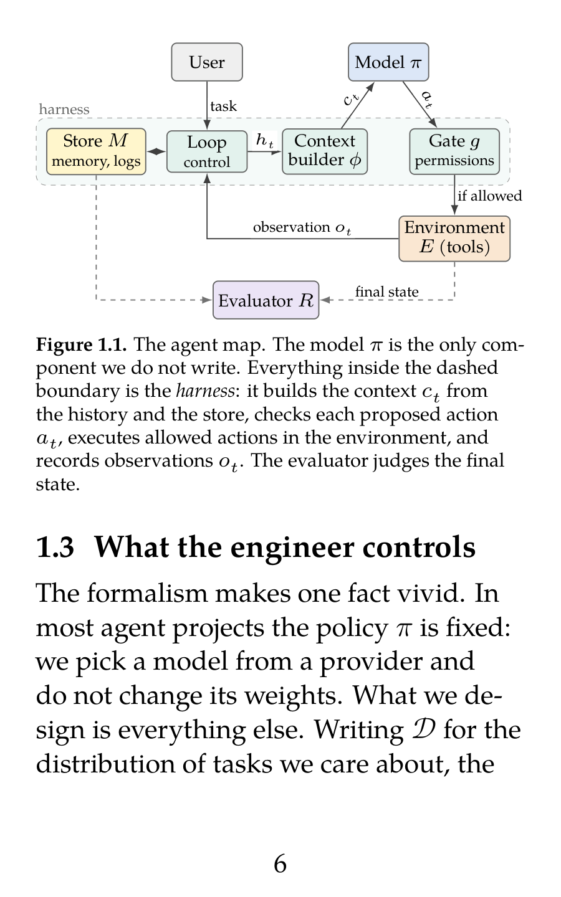
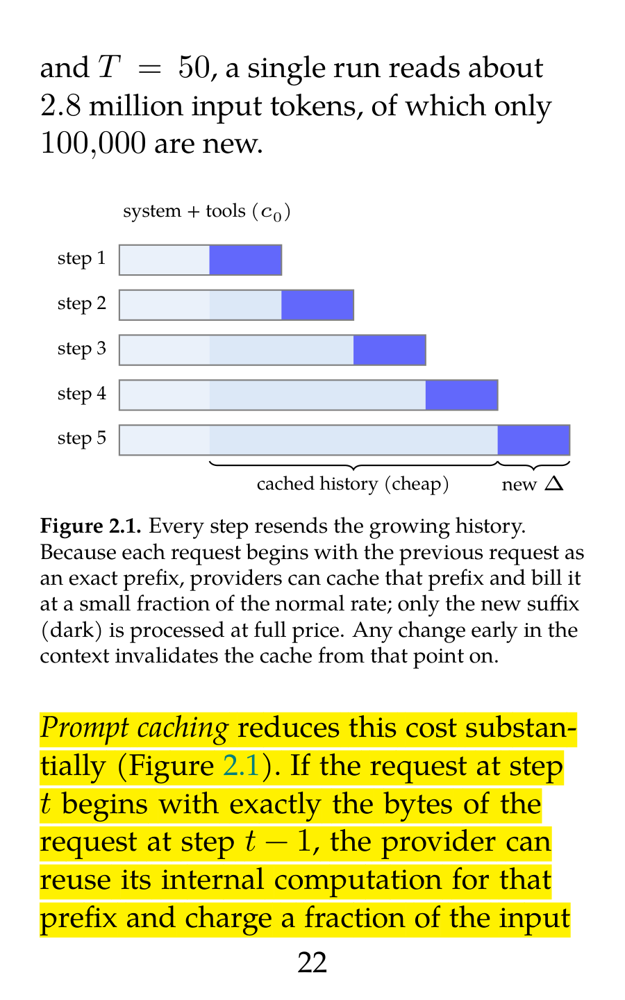
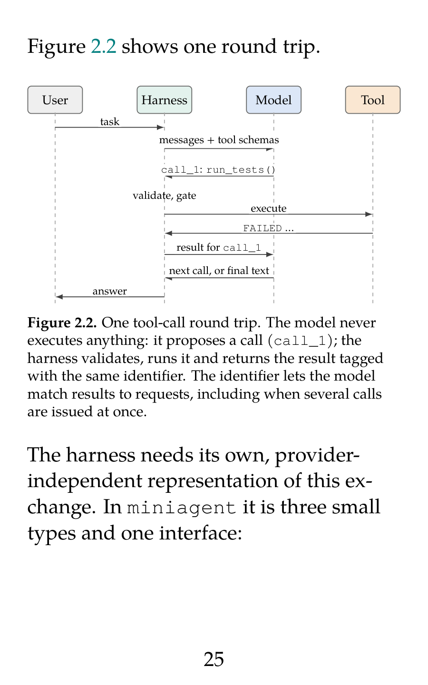

<!-- 原文页码：pp. 18–35（PDF 第 26–43 页） -->
---
title: 第 2 章 模型即策略
source: The Little Book of Agent Engineering
pages: 18-35
---

# 第 2 章 模型即策略



**我们在哪里。** 我们打开标着 $\pi$ 的那一格：一次模型调用是什么、为何其输出是随机的、成本是什么，以及编排层（harness）如何通过一个狭窄的、带类型的接口与它对话。

## 2.1 一次调用：文本进，分布出

语言模型在 token 上运作——来自固定词表的词片段；一个英文 token 平均三到四个字符。给定输入序列 $x$，模型通过对输出序列 $y = (y_1, \ldots, y_n)$ 一次预测一个 token 来定义概率分布，

$$
p_\theta(y \mid x) = \prod_{k=1}^{n} p_\theta(y_k \mid x, y_{<k}),
$$

其中 $\theta$ 是训练期间固定下来的权重。生成一次采样一个 token，直到遇到结束 token 或长度限制。诸如温度之类的采样参数会重塑每个条件分布，不过一些当前 API 已不再暴露它们；即便相同的请求也不必给出相同输出，因为服务系统以会改变浮点结果的方式批量计算。

对智能体设计者而言，有三件事比模型内部更重要。

1. **输出是随机的。** 第 1 章中的策略 $\pi(\cdot \mid c_t)$ 字面上就是一个分布。同一智能体在同一任务上的两次运行，可能在第一步就分叉，再不相遇。
2. **模型只知其权重与其上下文。** 不在 $c_t$ 中的任何东西——例如 `stats.py` 的当前内容——对它都是未知的，除非编排层放进去。训练期间学到的事实对本仓库可能过时或错误。
3. **成本与延迟随 token 缩放。** 提供商按输入与输出 token 计费，生成时间随输出长度增长。

## 2.2 消息、角色与无状态性

模型 API 接受消息列表，每条带有角色：带有常设指令的系统提示、带有任务的用户消息（在许多 API 中还包括工具结果），以及带有模型先前输出（包括工具调用）的助手消息。角色是模型被训练去遵守的约定，不是安全机制（第 9 章）。

模型 API 在根本上是无状态的：每个请求必须包含模型应考虑的一切。（注）因此编排层在每一步重发历史。这有一种值得推导的成本结构。假设每个请求的固定部分（系统提示与工具定义）是 $c_0$ 个 token，每一步追加 $\Delta$ 个 token（一次模型回复加一次工具结果）。第 $t$ 步的输入大约有 $c_0 + t\Delta$ 个 token，因此在 $T$ 步上总输入是

$$
\sum_{t=1}^{T} (c_0 + t\Delta) = T c_0 + \Delta \frac{T(T+1)}{2}.
$$

**总输入随步数二次增长。** 当 $c_0 = 5{,}000$、$\Delta = 2{,}000$、$T = 50$ 时，单次运行约读取 280 万输入 token，其中只有 10 万是新的。

**注：**一些提供商提供服务端会话状态或短生命周期线程，以避免重发历史。这些改变的是传输成本，不是逻辑：模型仍然以整段对话为条件。



图 2.1. 每一步重发不断增长的历史。因为每个请求都以先前请求作为精确前缀开头，提供商可以缓存该前缀，并以正常费率的一小部分计费；只有新后缀（深色）按全价处理。上下文靠前的任何改动都会从该点起使缓存失效。

提示缓存大幅降低这一成本（图 2.1）。若第 $t$ 步的请求以第 $t-1$ 步请求的字节精确开头，提供商可以复用对该前缀的内部计算，并对其收取输入价格的一小部分。缓存奖励一种我们将在第 5 章再次遇到的纪律：**保持上下文开头稳定，并使历史仅追加。** 在系统提示中插入时间戳，或在调用之间重排工具定义，都会悄无丢掉缓存 [48]。

机制解释了这条规则。模型分两阶段处理请求：**预填充（prefill）** 以一次并行遍读取整个输入，**解码（decode）** 则一次生成一个 token。在预填充期间，模型为每个输入 token 计算内部向量（其注意力层的键与值），供之后每个 token 查阅；服务系统把它们保存为 KV 缓存，使解码不必重新计算。每个向量取决于该 token 的位置以及它之前的一切。逐字节重复先前请求前缀的请求可以复用已存向量；在靠前位置插入哪怕一个 token，也会改变其后一切的位置，并从该点起强制重新计算 [79]。

延迟遵循同样的划分：首 token 时间由预填充主导并随上下文增长，而每个输出 token 的时间大致恒定。智能体在每一步都支付这两项，这是除价格之外、保持上下文小的第二个理由。

## 2.3 工具调用：带类型的契约

只能发出散文的模型无法可靠地操作计算机：编排层不得不从「让我看看 stats 文件」这类句子猜测该调用哪个函数、用哪些参数。当前模型被训练去发出工具调用（tool call）：结构化请求，从请求中提供的列表里命名一个工具，并给出匹配该工具 JSON Schema 的参数 [62]。编排层执行该调用，并在下一请求中把结果以同一标识符标记后返回。图 2.2 展示一轮往返。



图 2.2. 一次工具调用往返。模型从不执行任何东西：它提议一次调用（`call_1`）；编排层校验、运行它，并以同一标识符标记返回结果。该标识符让模型把结果与请求对应起来，包括一次发出多个调用的情况。

编排层需要自己的、与提供商无关的表示。在 `miniagent` 中，它是三个小类型和一个接口：

```python
@dataclass
class ToolCall:
    id: str
    # links call and result
    name: str
    # which tool
    args: dict[str, Any]
    # proposed arguments

@dataclass
class Reply:
    text: str = ""
    # prose for the user
    calls: list[ToolCall] = field(
        default_factory=list)
    raw: Any = None
    # provider-native content
    stop: str = "end_turn"
    # why generation ended

class Model(Protocol):
    def next(self, system: str,
             tools: list["Tool"],
             messages: list[dict]) -> Reply: ...
```

`ToolCall` 携带标识符、工具名与参数字典。`Reply` 是一次模型调用返回的内容：给用户的文本、零次或多次工具调用、提供商的原始内容（稍后需要），以及停止原因。`Model` 协议说：任何具有方法 `next(system, tools, messages)` 并返回 `Reply` 的东西，都可以充当策略。编排层中其他一切只依赖这些类型。

除了「完成」与「想要工具」，生成还可能因输出长度限制而停止，或因提供商拒绝请求而停止。把截断的回复当作最终答案是一种常见的静默失败；第 3 章的循环会显式处理这些情况。

### 语法、模式、含义

一次工具调用可能格式错误（无效 JSON）、违反模式（缺少参数、类型错误），或者格式正确却仍然错误（编辑了错误的行）。提供商往往能把解码约束到模式上，从而消除前两层；编排层仍应校验，因为并非每种模式都保证这一点。第三层只能由环境与评估器捕获。

## 2.4 行动前先推理

在给出答案前写出中间步骤（思维链推理）能提高多步问题的准确性 [72]，对若干采样出的链条做多数投票还能进一步提高 [68]。当前的推理模型把这一点内建进来，在每次输出前（包括工具调用之间）生成隐藏或摘要后的思考。一个「努力程度」设置用 token 与延迟换取准确性；合适的水平是一个经验问题。

对编排层有两点后果。思考内容通常必须在后续请求中原样传回（一些提供商会对其签名并拒绝被编辑的历史），这就是为何 `Reply` 保留原始内容。并且，陈述出的推理并不是可靠的审计日志：评判智能体应看其记录的动作及其效果，而非其叙述。

## 2.5 适配器

适配器在编排层的类型与某一提供商的线上格式之间翻译，因此模型更换时其余代码不必改动。下面是 Anthropic Messages API 的一个适配器，依据 2026 年末文档：

```python
class ClaudeModel:
    """Anthropic Messages API adapter."""
    def __init__(self, model="claude-opus-5-5",
                 max_tokens=16000):
        import anthropic
        # pip install anthropic
        self.client = anthropic.Anthropic()
        self.model = model
        self.max_tokens = max_tokens

    def next(self, system, tools, messages):
        resp = self.client.messages.create(
            model=self.model,
            max_tokens=self.max_tokens,
            system=system,
            tools=[{"name": t.name,
                    "description": t.description,
                    "input_schema": t.schema}
                   for t in tools],
            messages=to_wire(messages))
        calls = [ToolCall(b.id, b.name, b.input)
                 for b in resp.content
                 if b.type == "tool_use"]
        text = "".join(b.text for b in resp.content
                       if b.type == "text")
        return Reply(text, calls, raw=resp.content,
                     stop=resp.stop_reason)

def to_wire(messages: list[dict]) -> list[dict]:
    out: list[dict] = []
    for m in messages:
        role = m["role"]
        if role == "user":
            out.append({"role": "user",
                        "content": m["content"]})
        elif role == "assistant":
            # verbatim
            out.append({"role": "assistant",
                        "content": m["reply"].raw})
        else:
            # tool results go in a user turn
            block = {"type": "tool_result",
                     "tool_use_id": m["call_id"],
                     "content": m["content"],
                     "is_error": m["is_error"]}
            last = out[-1] if out else None
            if (last and last["role"] == "user"
                    and isinstance(last["content"],
                                   list)):
                last["content"].append(block)
            else:
                out.append({"role": "user",
                            "content": [block]})
    return out
```

适配器做了三件值得复制到任何实现中的事。它以名称、描述与 JSON Schema 发送工具定义——这是跨提供商的公约数。它在下一请求中原样返回助手内容，从而保留思考块与任何提供商特有结构。它把连续的工具结果归入同一用户轮次——这是该 API 期望并行工具调用结果的返回方式。

协议的第二种实现 `ScriptedModel` 重放固定的回复脚本。它以确定性、离线且免费的方式测试编排层，但不衡量真实模型是否会选择那些动作；那需要第 10 章的评估。

## 2.6 选择模型

模型选择在能力、成本与延迟之间权衡，基准测试只能粗略预测你的任务。三条经验法则：

- **按完成任务的成本度量，而非按 token。** 更便宜的模型若需要两倍步数，或三分之一时间失败，并不更便宜。
- **从负担得起的最强模型起步，再往下移。** 它确立什么是可达的；只有那时才清楚较小模型的失败属于模型还是属于编排层。
- **不同角色可用不同模型。** 代表主智能体浏览文件的辅助智能体（子智能体，第 8 章），或检查格式的模型（评分器，第 10 章），往往可用比主循环更小、更快的模型。
- **编排层是度量的一部分。** 同一模型在同一基准、不同编排层下得分不同，差距往往与模型之间的差距一样大 [79, 67]。为一个模型引用的数字，是该模型在某个人的编排层之内的数字。

每次实验记录确切的模型标识符与努力程度；静默切到新版本的别名就是对 $\pi$ 的一次改动。

## 小结

- 一次模型调用从学得的条件分布中采样 token。输出是随机的；模型只知其权重与其上下文。
- API 是无状态的，因此每一步重发历史，总输入随步数二次增长。提示缓存使稳定、仅追加的前缀变得便宜。
- 工具调用是带类型的契约：模型提议 `(id, name, args)`；编排层校验、执行并以同一 `id` 返回结果。
- 适配器隔离提供商细节。脚本化模型测试编排层；它不度量模型。

## 本章如何衔接

第 3 章把 `Model` 接口包进图 1.1 的循环。二次成本与缓存纪律会在第 5 章再现——那时上下文窗口成为中心资源。模型选择在第 10 章作为受控实验再出现。

## 习题

**2.1** 某智能体的系统提示与工具占用 $c_0 = 8{,}000$ 个 token；每一步追加 $\Delta = 1{,}500$。计算 $T = 20$ 与 $T = 80$ 时的总输入 token。若缓存前缀 token 的费用为正常输入价格的 10%，且每个请求除其新的 $\Delta$ token 外全部命中缓存，则在 $T = 80$ 时，缓存把输入成本降低了多少倍？

**2.2** 提供商返回一条回复，停止原因为「达到最大输出 token」，文本在句子中间结束，且没有工具调用。解释朴素循环会做什么，以及循环应当做什么。
