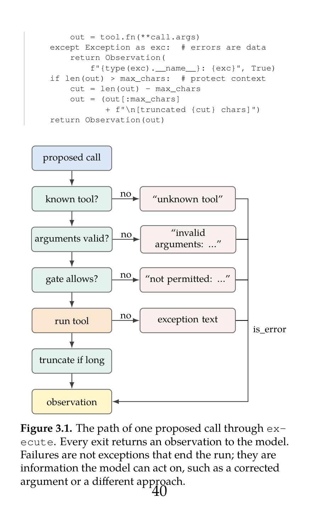
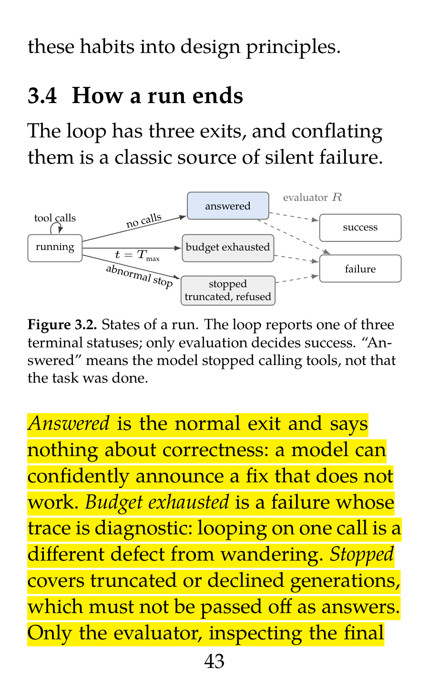

# 第 3 章　循环

**我们所处的位置。** 我们实现连接各组件的控制循环：大约四十行代码，调用模型、执行动作、记录观察，并决定何时停止。

## 3.1 代码中的循环

下面把第 1 章的方程写成一个 Python 函数；请对照图 1.1 阅读。

```python
def run(task: str, model: Model,
        tools: list[Tool], *,
        system="You are a careful assistant.",
        gate=allow_all, view=lambda m: m,
        max_steps=30, log=lambda e: None):
    registry = {t.name: t for t in tools}
    messages = [{"role": "user", "content": task}]
    for step in range(1, max_steps + 1):
        # 1. policy: choose the next action
        reply = model.next(system, tools,
                           view(messages))
        messages.append({"role": "assistant",
                         "reply": reply})
        log({"step": step, "text": reply.text,
             "calls": [(c.name, c.args)
                       for c in reply.calls]})
        # 2. termination
        if reply.stop not in ("end_turn",
                              "tool_use"):
            return Result("stopped", reply.text,
                          messages, step)
        if not reply.calls:
            return Result("answered", reply.text,
                          messages, step)
        # 3. act and observe
        for call in reply.calls:
            obs = execute(call, registry, gate)
            messages.append({
                "role": "tool", "call_id": call.id,
                "content": obs.content,
                "is_error": obs.is_error})
            log({"step": step, "call": call.id,
                 "error": obs.is_error,
                 "observation": obs.content[:200]})
    return Result("budget_exhausted", None,
                  messages, max_steps)
```

每一行都对应形式化循环中的一项：

- `messages` 是历史 $h_t$。它以任务 $u$ 开始，每一步增加一条助手记录，以及每个工具结果一条记录。
- `view(messages)` 是上下文构建器 $\phi$。这里默认是恒等映射，因此模型能看到一切；第 5 章会用更聪明的实现替换它，而无需改动循环本身。
- `model.next(…)` 采样 $a_t \sim \pi(\cdot \mid c_t)$。
- `execute(call, registry, gate)` 应用门控 $g$，若允许则调用环境 $E$，返回观察 $o_t$。
- `max_steps` 是预算 $T_{\max}$；三处 `return` 语句实现停止时刻 $\tau$。
- `log` 在上下文之外写入事件记录，这是存储 $M$ 的开端。

循环中没有规划器，也没有硬编码的步骤序列。模型决定下一步做什么；编排层（harness）决定什么可行，并记录发生了什么。之后加入的一切，都接入 `view`、`gate`、`tools` 或 `log` 这些参数之一。

## 3.2 执行一次调用

`execute` 函数是提案与世界相遇之处。它依次应用四道防护，每一次失败都变成观察，而不是异常。

```python
def execute(call: ToolCall, tools: dict,
            gate, max_chars=8000) -> Observation:
    tool = tools.get(call.name)
    if tool is None:
        return Observation(
            f"unknown tool {call.name!r}", True)
    problem = validate(tool, call.args)
    if problem:
        return Observation(
            f"invalid arguments: {problem}", True)
    verdict = gate(tool, call.args)
    # "allow"
    if verdict != "allow":
        # or a reason
        return Observation(
            f"not permitted: {verdict}", True)
    try:
        out = tool.fn(**call.args)
    except Exception as exc:
        # errors are data
        return Observation(
            f"{type(exc).__name__}: {exc}", True)
    if len(out) > max_chars:
        # protect context
        cut = len(out) - max_chars
        out = (out[:max_chars]
               + f"\n[truncated {cut} chars]")
    return Observation(out)
```



**图 3.1.** 一次提案调用经 `execute` 的路径。每一条出口都向模型返回一条观察。失败不是终止运行的异常；它们是模型可据此行动的信息，例如修正参数或换一种做法。

顺序很重要。一个幻觉出的工具名（模型自己发明的）会得到精确的消息；权限逻辑永远看不到畸形输入；被拒绝的动作完全不产生任何效果；而缺失的文件会变成可读文本：“FileNotFoundError: stats2.py” 是一条好观察，有能力的模型会据此去列出目录。

这正是第 1 章“错误复合”论证的代码体现：每一道防护检测一类错误并回报，从而提高 $d$。截断则保护上下文窗口，并声明自己做了截断，以便模型可以请求更窄的视图。

## 3.3 运行示例的轨迹

运行离线演示会产出该次运行的轨迹——其动作与观察的记录，见表 3.1。模型是脚本化的，因此序列是固定的，但这正是有能力的模型通常会遵循的序列，也展示了编排层（harness）在履行其职责。

**表 3.1.** 演示运行。每一步是一次模型调用；观察已缩写。

| $t$ | 动作 $a_t$ | 观察 $o_t$ |
| --- | --- | --- |
| 1 | `run_tests()` | `FAILED: expected [10, 15, 25, 35], got [15, 25, 35, 40]` |
| 2 | `read_file(stats.py)` | 带行号的源码；第 11 行是 `window = xs[i:i + w]` |
| 3 | `edit_file(…)` 将其替换为 `xs[max(0,i-w+1):i+1]` | `edited stats.py` |
| 4 | `run_tests()` | `PASSED, 2 tests` |
| 5 | 最终文本 | “Fixed: the window looked forward …” |

三种习惯清晰可见。智能体先观察再行动：失败输出显示了前移的数值，几乎就能定位 bug。编辑是最小且可检查的。智能体在宣称成功之前先验证：第 4 步把“我修好了”变成证据。第 4 章与第 7 章会把这些习惯变成设计原则。

## 3.4 一次运行如何结束

循环有三种出口，把它们混为一谈是静默失败的经典来源。



**图 3.2.** 一次运行的状态。循环报告三种终端状态之一；只有评估才决定成功。“已作答”意味着模型停止调用工具，并不意味着任务已完成。

**已作答（answered）** 是正常出口，却不说明正确性：模型可以自信地宣布一个并不奏效的修复。**预算耗尽（budget exhausted）** 是一种失败，其轨迹具有诊断价值：在同一次调用上打转，与四处游荡是不同的缺陷。**已停止（stopped）** 涵盖被截断或被拒绝的生成，绝不能把它们冒充成答案。只有评估器检查最终状态，才决定成功。

生产环境中的编排层还会限制 token、时间与金钱，并允许在步骤之间取消。步骤上限无法打断挂起的工具；那需要超时或进程边界（第 9 章）。

## 3.5 为何采用简单循环

该循环源自 ReAct：它表明，把推理与动作、观察交错进行，优于单独使用其中任何一种 [82]。那篇论文的两个细节预示了本书其余部分。在其失败分析中，没有动作的思维链推理在超过一半的错误里幻觉出事实，而能够搜索的版本一个幻觉都没有：行动把推理锚定在观察上。此外，在推理与行动轨迹上微调的小模型（在该行为的示例上进一步训练）击败了仅被提示去产生这些轨迹的大得多的模型。早期框架把循环包在规划器、任务队列与角色层级里；随着模型变强，其中许多不再划算，而当前对有能力模型的实践接近最小循环：好的工具、管理良好的上下文、清晰的任务 [4]。

改进有具体的形式。提供商如今会在智能体任务上对模型做后训练（在最初的文本训练之后进一步训练），这些任务有可验证的结果——例如向仓库程序性注入 bug，当隐藏测试再次通过时给予奖励；一种这样的配方把一个开源的 320 亿参数模型在 SWE-bench Verified（真实 GitHub issue 的基准，第 10 章）上从约 9% 提升到约 40% [81]。早期编排层不得不脚本化的行为（规划、先观察再行动、先验证再停止）越来越多地进入了权重。结构从控制流中移出，进入工具、上下文与验证——这是“苦涩教训”的一个局部实例：利用计算的通用方法击败手工工程化的结构 [66]。

循环已经能在一次回复中处理多个工具调用（一次读三个文件）；并发运行它们是一种优化，仅对独立调用有效。

## 3.6 测试编排层

因为模型在接口之后，编排层可以用脚本化模型进行离线、确定性测试。配套测试套件会检查（除其他事项外）：

- 脚本化修复留下一个测试通过的仓库；
- 在审批者拒绝每一次编辑时，编辑被拒绝，拒绝作为观察到达模型，且仓库未变；
- 永不停止调用工具的模型，在恰好 $T_{\max}$ 步后以状态 `budget_exhausted` 结束且没有答案；
- 被截断的生成以状态 `stopped` 结束，而不是 `answered`；
- 未知工具、无效参数与工具异常都变成错误观察。

这些测试表明：给定一系列决策，编排层行为正确——而不是模型会决策得好。编排层的 bug 由单元测试发现；模型行为由评估来度量。

## 小结

- 循环很短：构建上下文，调用模型；若没有工具调用则停止，否则执行每一次调用并追加观察。
- `execute` 把每一次失败（未知工具、无效参数、拒绝、异常）变成观察，从而保持反馈回路闭合。
- 一次运行以已作答、预算耗尽或已停止结束；只有对最终状态的评估才决定成功。
- 保持循环简单；把结构放进工具、上下文与验证。用脚本化模型测试编排层。

## 本章如何衔接

循环有四个插件点，后续章节分别填充它们：工具（第 4 章）、`view`（第 5、6 章）、`gate`（第 9 章）与 `log`（第 7、10 章）。第 8 章表明，整个智能体本身也可以被封装成一个工具。

## 习题

**3.1** 一个脚本化模型每一步都调用 `run_tests` 且从不作答。在 `max_steps=5` 时，`run` 返回什么，`messages` 含有多少条记录，以及为何把最后一条观察当作“答案”返回是错误的？

**3.2** 假设 `execute` 在验证参数之前调用门控。描述一种使这种顺序产生令人困惑观察的输入，以及一种使其成为安全问题的输入。
