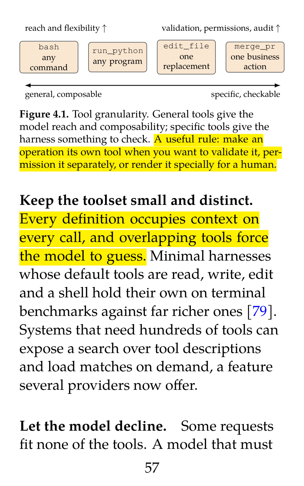
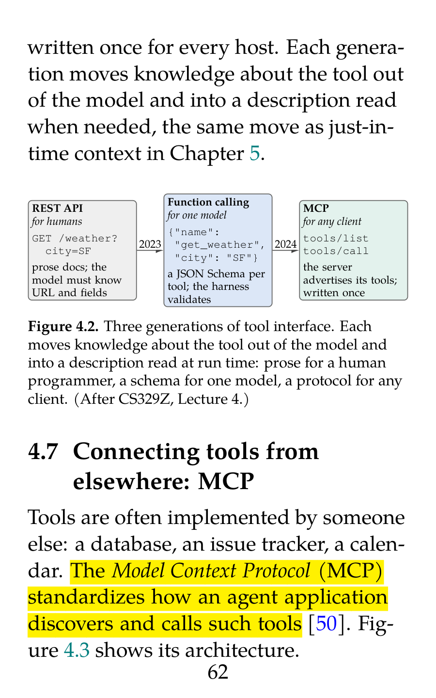
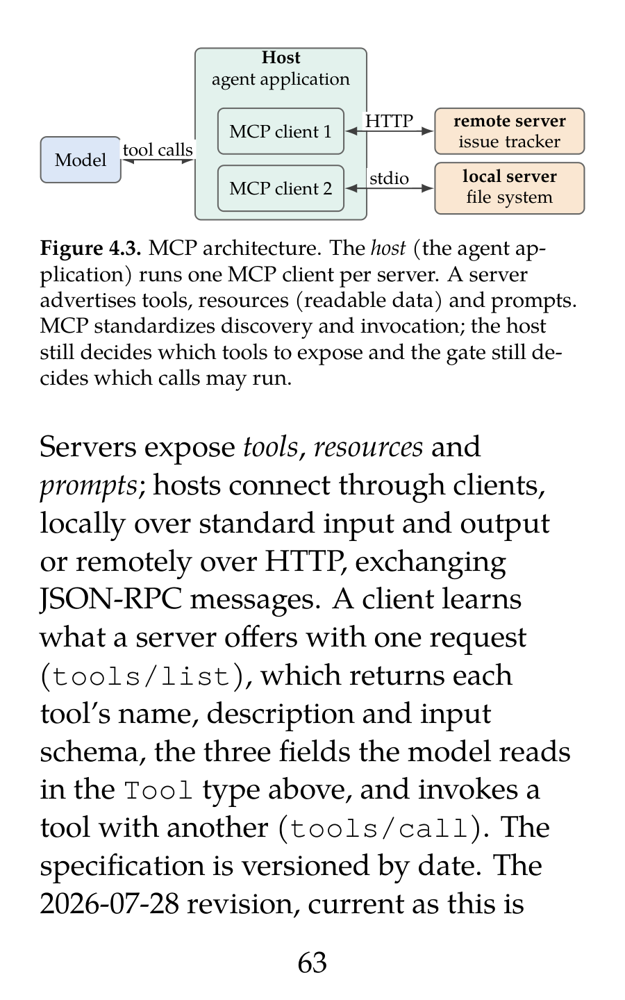
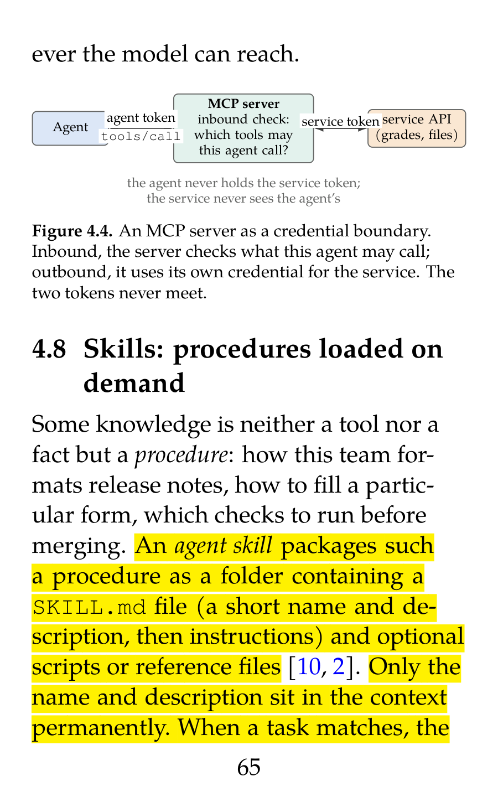

# 第 4 章　工具：设计动作空间

**我们所处的位置。** 我们设计 $\mathcal{A}$——模型可以提案的动作集合，以及这些动作返回的观察。工具是智能体影响世界的唯一方式，也是它了解世界的主要方式。

## 4.1 为何需要工具

模型在文本、代码与数学上很强，但在三种反复出现的情形中很弱（表 4.1）。第一种是精确、冗长或可验证的计算：多位数乘法的准确率随位数稳步下降——对推理模型亦然——谜题与动态规划也随问题规模增大而同样如此 [23]。第二种是权重无法容纳的知识：今天的天气、私有数据库、训练截止之后的任何事、`stats.py` 的当前内容。第三种是根本不是语言的接口：文件系统、API、浏览器、设备。每种情形的补救办法相同：模型把请求写成文本，外部程序完成工作并回报。

**表 4.1.** 模型单独不足的地方，以及应对每种局限的工具。

| 局限 | 典型情形 | 工具 |
| --- | --- | --- |
| 精确或冗长的计算 | 算术、多步演绎、在大量情形上搜索 | 计算器、代码执行、求解器、检查器 |
| 权重之外的知识 | 当前事实、私有数据、本仓库 | 搜索、检索、数据库、实时 API |
| 非语言接口 | 文件、服务、设备、物理世界 | 函数调用、工具协议（第 4.7 节）、浏览器、shell |

## 4.2 工具作为面向模型的接口

一个工具有五个部分，在 miniagent 的 `Tool` 类型中全部可见：

```python
@dataclass
class Tool:
    name: str
    description: str
    # written for the model
    params: dict[str, dict]  # JSON-Schema properties
    fn: Callable[..., str]
    # implementation
    effect: str = "read"
    # read|write|execute|
    # external
    @property
    def schema(self) -> dict:
        return {"type": "object",
                "properties": self.params,
                "required": list(self.params),
                "additionalProperties": False}
```

`name`、`description` 与 `schema` 由模型阅读；它们是一种用户界面，而其用户是语言模型。实现是普通代码。效果类别由编排层（harness）阅读：它说明工具是只读、写入本地状态、执行代码，还是触及系统之外，第 9 章的门控用它来决定什么需要许可。

SWE-agent 的作者把这一层称为智能体–计算机接口（agent–computer interface），并表明：在模型固定的情况下，其设计会大幅改变成功率 [80]：显示带行号的有界窗口的查看器优于原始的 `cat`；摘要式搜索优于倾倒全部匹配；拒绝破坏语法的编辑的编辑器优于不拒绝的。没有任何一项让模型更聪明；它们都让观察更有信息量，并让错误更易检测。

以下是我们运行示例的工具集：

```python
def tools(self) -> list[Tool]:
    s = {"type": "string"}
    return [
        Tool("list_files",
             "List all files in the repository.",
             {}, self.list_files),
        Tool("read_file",
             "Read a file; lines are numbered.",
             {"path": s}, self.read_file),
        Tool("search",
             "Regex search over *.py files. "
             "Returns 'file:line: text' per match.",
             {"pattern": s}, self.search),
        Tool("edit_file",
             "Replace the unique occurrence of "
             "'old' by 'new' in a file. Fails if "
             "'old' is missing or not unique.",
             {"path": s, "old": s, "new": s},
             self.edit_file, effect="write"),
        Tool("run_tests",
             "Run the unit tests. Returns PASSED, "
             "or FAILED with the failure report.",
             {}, self.run_tests, effect="execute"),
    ]
```

每个工具做一件事，返回为模型设计的文本，并声明其效果。

## 4.3 工具设计原则

**返回模型下一步决策所需的内容。** `read_file` 给行编号，以便模型可以引用它们；`search` 返回 `file:line: text`，以便可以直接打开命中；`run_tests` 以 `PASSED` 或 `FAILED` 开头，即使报告被截断，结果也毫不含糊。优先使用有意义的标识符（文件路径、名称）而非不透明的标识符（数据库行 id），优先使用自然语言摘要而非原始倾倒 [11]。

**让错误具有指导性。** 编辑器要求被替换的字符串恰好出现一次：

```python
def edit_file(self, path, old, new) -> str:
    target = self.resolve(path)
    text = target.read_text()
    n = text.count(old)
    if n != 1:
        # an error the model can act on
        raise ValueError(
            f"'old' must occur exactly once; "
            f"found {n}. Include more context.")
    target.write_text(text.replace(old, new))
    return f"edited {path}"
```

一个含糊的 `old` 字符串会得到一条说明找到了多少处匹配以及该怎么做的错误。光秃秃的 `ValueError` 不给模型任何可行动的信息；静默替换第一处匹配则“成功地”做错了事。具有指导性的错误提高 $d$；静默的错误行为降低它。

**限制输出。** 对一个 10,000 行的文件做一次 `read_file` 就能填满窗口。优先使用分页、过滤或摘要的工具，把截断作为会自我声明的后备手段。

**有意识地选择粒度。** 一个 bash 工具能做 shell 能做的任何事，包括你未曾预料的；具体工具更易于验证、授权与审计（图 4.1）。许多编码智能体把用于探索的 shell 与用于编辑的专用工具结合起来。



**图 4.1.** 工具粒度。通用工具给模型触及面与可组合性；具体工具给编排层（harness）可检查的对象。一条有用的规则：当你想单独验证、单独授权，或为人特别渲染某项操作时，就把它做成独立工具。

**保持工具集小而分明。** 每一个定义在每一次调用上都占据上下文，重叠的工具迫使模型猜测。默认工具仅为读、写、编辑与 shell 的最小编排层，在终端基准上仍能与远更丰富的系统抗衡 [79]。需要数百个工具的系统可以对工具描述做搜索，并按需加载匹配项——若干提供商现已提供这一能力。

**让模型可以拒绝。** 有些请求不适合任何工具。必须调用某物的模型会调用最近似的：乘法请求变成对唯一可用算术工具 `add` 的调用。让不作工具调用的作答变得容易，并在评估中包含这类情形。Berkeley Function Calling Leaderboard 单独为这种相关性检测打分，与并行调用和多轮使用并列 [58]。

**为有能力的新人撰写描述。** 说明工具做什么、何时使用、返回什么及其陷阱；“若 `old` 不唯一则失败”可以防止一类错误。然后阅读转录并修订：描述就是提示，值得评估 [11]。

## 4.4 效果与可逆性

效果类别是从工具通向安全的桥梁。表 4.2 给出本书使用的类别。它们按后果有多难撤销排序——这正是决定授予多少自主性时重要的性质。

**表 4.2.** 效果类别。第 9 章的门控按类别分配权限。

| 效果 | 示例 | 撤销 |
| --- | --- | --- |
| read | 列出、读取、搜索 | 无可撤销 |
| write | 编辑工作副本中的文件 | 版本控制 |
| execute | 运行测试、运行脚本 | 取决于代码 |
| external | 发邮件、部署、支付 | 往往不可能 |

优先采用受控效果（在版本控制下编辑工作副本；暂存草稿而非发送），并把准备与承诺分开：智能体可以准备拉取请求或支付，由人或更严格的门控批准外部步骤。

## 4.5 代码作为动作语言

许多小工具之外的另一种选择，是让模型编写程序：动作空间变成一种编程语言，编排层在沙箱——限制程序可触及范围的执行环境（第 9 章）——中运行脚本。可执行的 Python 动作已被证明在多工具任务上优于 JSON 工具调用 [70]，因为它们可组合：对二十个文件的循环是一次动作，而不是穿过上下文的二十个来回。

来自 MCP 服务器（下一节）的工具同样可以作为代码库呈现，使中间结果不进入上下文 [6]。代价是：模型写的代码需要真正的隔离（第 9 章），并且更难按调用逐次授权。

## 4.6 工具接口的三代演进

谁在何时教模型关于工具的知识？早期系统把它训练进去。Toolformer 通过检查一次调用是否降低后续文本的损失，学习在何处插入对五个固定工具的调用 [62]；Gorilla 在数千次 API 调用上微调模型，并通过解析每次调用并对照真实 API 树来度量幻觉调用 [57]。训练把模型绑在一套工具上，而工具集每天都在变。实践落在另一个答案上：在运行时以任何模型都能阅读的格式描述工具。三代接口标志着这一转变（图 4.2）。

REST API 用面向人类程序员的散文文档说明；使用它的模型必须知道 URL、参数名与响应形状。2023 年引入的函数调用把 JSON Schema 交给模型并接收类型化调用，编排层在运行前验证它。下文的 MCP 把描述移入协议：服务器通告其工具，任何客户端用一次请求发现它们，服务器为每一个宿主只写一次。每一代都把关于工具的知识从模型中移出，移入在需要时阅读的描述——与第 5 章的即时上下文是同一种移动。



**图 4.2.** 工具接口的三代。每一代都把关于工具的知识从模型中移出，移入运行时阅读的描述：面向人类程序员的散文、面向一个模型的 schema、面向任何客户端的协议。（据 CS329Z 第 4 讲。）

## 4.7 连接别处的工具：MCP

工具常常由别人实现：数据库、问题跟踪器、日历。模型上下文协议（Model Context Protocol，MCP）标准化了智能体应用如何发现并调用这类工具 [50]。图 4.3 展示其架构。



**图 4.3.** MCP 架构。宿主（智能体应用）为每个服务器运行一个 MCP 客户端。服务器通告工具、资源（可读数据）与提示。MCP 标准化发现与调用；宿主仍决定暴露哪些工具，门控仍决定哪些调用可以运行。

服务器暴露工具、资源与提示；宿主通过客户端连接，本地经标准输入输出，或远程经 HTTP，交换 JSON-RPC 消息。客户端用一次请求（`tools/list`）了解服务器提供什么——返回每个工具的名称、描述与输入 schema，即上文 `Tool` 类型中模型阅读的三个字段——并用另一次请求（`tools/call`）调用工具。规范按日期版本化。写作时现行的 2026-07-28 修订使核心协议变为无状态（每次请求携带自己的版本与能力），并把长时任务等功能移入扩展 [49]。

MCP 改变的是工具从何而来，而不是它们是什么：MCP 工具仍占据上下文，返回可能很大或带对抗性的观察，并经过门控。你无法控制的服务器是不信任文本的来源（第 9 章）。

你能控制的服务器则是凭证边界的自然位置（图 4.4）。智能体出示自己的令牌；服务器检查该智能体可以使用哪些工具，并用智能体永远看不到的另一份凭证访问底层服务。一门课的评分工具可以对学生的智能体隐藏，同时暴露其列表工具；泄露的智能体令牌也不会泄露服务的令牌 [79]。第 9 章把这一原则推广：凭证留在模型能触及的范围之外。



**图 4.4.** 作为凭证边界的 MCP 服务器。入站，服务器检查该智能体可以调用什么；出站，它用自己的凭证访问服务。两份令牌永不相遇。

## 4.8 技能：按需加载的规程

有些知识既不是工具也不是事实，而是规程：本团队如何格式化发布说明、如何填写某张表单、合并前要跑哪些检查。智能体技能把这类规程打包成一个文件夹，内含 `SKILL.md` 文件（简短名称与描述，然后是说明）以及可选的脚本或参考文件 [10, 2]。只有名称与描述永久留在上下文中。当任务匹配时，智能体阅读完整说明，并由此读取任何被引用的文件或脚本。这种渐进式披露把大型技能库的常驻成本压到每个仅几十个 token。技能因此坐落在本章与下一章的边界上：它们扩展智能体能做的事，并通过管理它所见到的内容来做到这一点。

## 小结

- 工具覆盖权重做不到的事：精确计算、训练之外的知识，以及非语言的接口。
- 一个工具是名称、描述与 schema（由模型阅读）、实现，以及效果类别（由编排层阅读）。
- 好的工具返回下一步决策所需内容，让错误具有指导性，限制其输出，数量少而分明，并留出不调用任何工具的空间。
- 工具知识从模型移入运行时描述：面向人类的散文、面向一个模型的 schema、面向任何客户端的协议。
- 把效果分为 read、write、execute 或 external，并优先采用受控、可逆的效果；把准备与承诺分开。
- 代码即动作把许多操作组合成一次；MCP 标准化外部工具的发现与调用；技能按需加载规程。

## 本章如何衔接

工具输出是上下文的最大消费者，这是第 5 章的主题。搜索工具是智能体的检索机制（第 6 章）。效果类别驱动权限（第 9 章），而工具描述是评估暴露失败时最先要调的事物之一（第 10 章）。

## 习题

**4.1** 为文件可达 20,000 行的仓库重新设计 `read_file`。说明其参数、输出格式，以及当请求将超过 300 行时返回的错误或通知。

**4.2** 运维智能体需要重启服务。比较 bash 工具与 `restart_service(name)` 工具：门控能检查什么、审计日志记录什么，以及什么可能出错。
