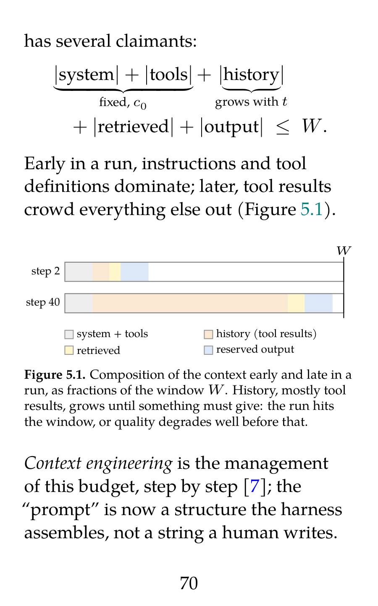
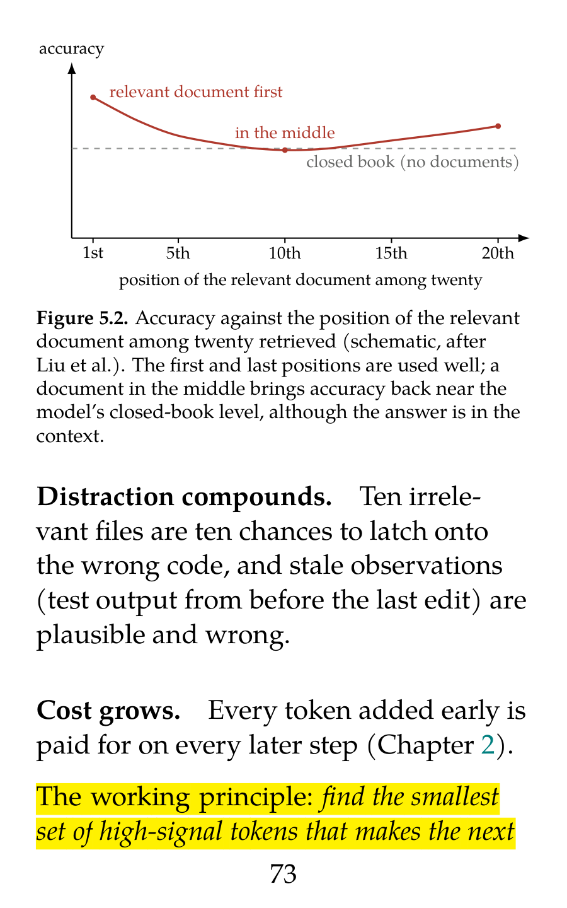
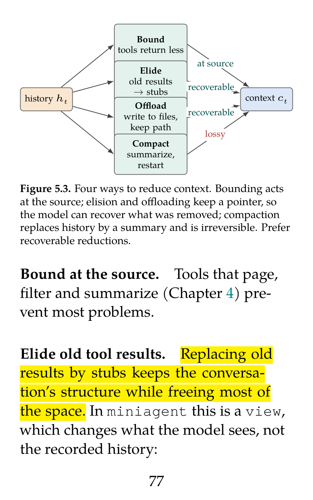
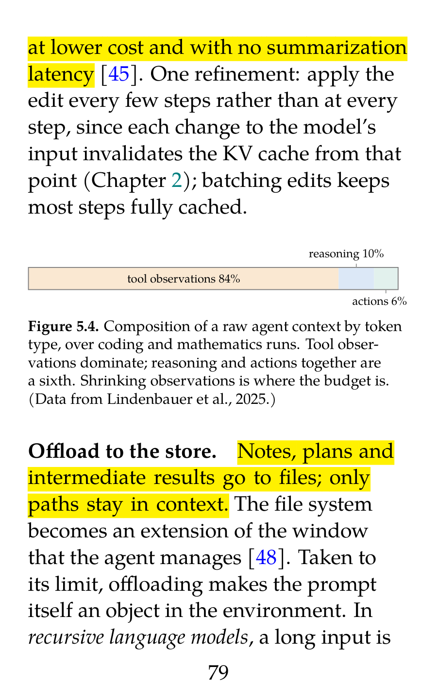

# 第 5 章　上下文工程

**我们所处的位置。** 我们设计 $\phi$——把历史与存储变成模型实际所见内容的函数。上下文是模型在每一步的整个世界，而且它是稀缺资源。

## 5.1 上下文即智能体的世界

在步骤 $t$，模型以 $c_t$ 为条件，别无其他：智能体关于任务、进度与规则所“知道”的一切，就是 $\phi$ 放进去的一切。窗口 $W$ 有多个争夺者：

$$
\underbrace{|\mathrm{system}| + |\mathrm{tools}|}_{\text{固定，}c_0}
+ \underbrace{|\mathrm{history}|}_{\text{随 }t\text{ 增长}}
+ |\mathrm{retrieved}| + |\mathrm{output}| \le W.
$$

运行早期，指令与工具定义占主导；之后，工具结果把其他一切挤出去（图 5.1）。



**图 5.1.** 运行早期与晚期上下文的构成，以窗口 $W$ 的比例表示。历史（主要是工具结果）增长，直到必须有所让步：运行撞上窗口，或质量在那之前就已下降。

上下文工程就是逐步管理这一预算 [7]；“提示”如今是编排层（harness）组装的结构，而不是人写的字符串。

## 5.2 为何更多上下文并不更好

三种效应反对填满窗口。

**注意力有限。** Transformer 从每个 token 关注到每个其他 token；随着上下文增长，每个相关 token 与更多无关 token 竞争。经验上，模型对放在长上下文开头或结尾的信息，比放在中间的检索更可靠——这就是“迷失在中间”（lost-in-the-middle）效应 [47]。超越简单“大海捞针”检索的基准发现，有效上下文长度——性能得以维持的长度——往往远低于标称窗口 [29]。一项对十八个模型的研究发现，即使在简单任务上，性能也随输入长度增长而下降，作者称之为上下文腐烂（context rot）[28]。细节因模型与代际而异，并随每代改善；方向不变。

图 5.2 展示了最初的迷失在中间实验。一个从二十篇检索文档中作答的模型，在相关文档排第一时表现最好，排最后时几乎同样好，排在中间时最差——准确率回落到大约与没有任何文档时相当。同一研究还改变了文档数量：答案落在检索集合中的概率在超过五十篇后仍在上升，而阅读器的准确率在十到二十篇之后就不再提升 [47]。两条曲线之间的差距，就是上下文中模型无法使用的证据。



**图 5.2.** 准确率相对于相关文档在二十篇检索文档中的位置（示意，据 Liu 等人）。首尾位置利用得好；中间的文档使准确率回到接近模型的闭卷水平，尽管答案就在上下文中。

**干扰会复合。** 十个无关文件是十次抓住错误代码的机会，而陈旧的观察（上次编辑之前的测试输出）既可信又错误。

**成本在增长。** 早期加入的每一个 token，在之后每一步都要付费（第 2 章）。

工作原则是：**找到使下一步决策很可能正确的、最小的高信号 token 集合** [7]。

## 5.3 上下文即选择

把 $\phi$ 看成一个优化问题会有帮助。设候选项为指令、工具定义、过往消息、工具结果、检索段落与笔记，其中项目 $i$ 大小为 $s_i$ 个 token，对下一步决策有某种价值 $v_i$。则 $\phi$ 选择集合 $S$ 以

$$
\max_{S} \sum_{i \in S} v_i
\quad\text{subject to}\quad
\sum_{i \in S} s_i \le W - r,
$$

其中 $r$ 为输出预留空间。这是一个背包问题：它奖励每 token 的价值。价值未知且会漂移（失败测试的输出在第 1 步至关重要，修复之后一文不值），因此实践中的构建者使用规则：始终保留指令与任务，保留近期步骤，压缩旧工具结果，按需检索。关键在于，廉价的引用也可以是候选项：一条文件路径只花几个 token，并让模型在证明有价值时再取回内容。上下文工程很大一部分就是用引用替换内容。

## 5.4 布局：稳定前缀、只追加历史

在决定移除什么之前，先决定东西放在哪里。

- **把稳定材料放在前面。** 系统提示与工具定义应在各步骤间字节级相同，以便命中第 2 章的提示缓存。动态内容（日期、用户名、检索段落）放在后面。
- **追加；不要改写。** 编辑早期消息会使其后一切的缓存失效，且某些提供商拒绝含有推理块的已编辑历史。若某个工具应变为不可用，往往更好在门控中拒绝对其的调用，而不是在运行中途移除其定义 [48]。
- **保持错误可见。** 失败的动作及其错误消息教模型不要重复什么。静默移除失败会诱使模型再试同一件事 [48]。
- **在靠近末尾处重述目标。** 在长运行中，一段简短、更新过的目标与剩余步骤陈述（智能体维护的待办列表）把当前计划保持在模型最可靠关注的上下文区域。

## 5.5 缩小模型所见内容的四种方式

当上下文变得过大时，有四类补救办法（图 5.3）。它们的作用位置不同，所移除的信息是否可恢复也不同。



**图 5.3.** 减少上下文的四种方式。限制在源头起作用；省略与卸载保留指针，因此模型可以恢复被移除的内容；压缩用摘要替换历史，不可逆。优先采用可恢复的缩减。

**在源头限制。** 能分页、过滤与摘要的工具（第 4 章）能防止大多数问题。

**省略旧工具结果。** 用存根替换旧结果，在释放大部分空间的同时保持对话结构。在 miniagent 中这是一个 `view`，它改变模型所见，而不改变已记录的历史：

```python
def elide_old_results(keep_last=4, min_chars=500):
    """Replace all but the last `keep_last` long
    tool results by a stub. The history itself is
    untouched; only the model's view shrinks."""
    def view(messages: list[dict]) -> list[dict]:
        idx = [i for i, m in enumerate(messages)
               if m["role"] == "tool"]
        old = set(idx[:-keep_last] if keep_last
                  else idx)
        out = []
        for i, m in enumerate(messages):
            n = len(m.get("content") or "")
            if i in old and n > min_chars:
                m = {**m, "content":
                     f"[elided {n} chars; call the "
                     "tool again if needed]"}
            out.append(m)
        return out
    return view
```

存根说明如何恢复内容，因此省略是可恢复的。提供商在服务端以“上下文编辑”提供同样的操作。省略值得首先尝试，因为观察主导预算。在编码与数学任务的实测智能体运行中，工具观察约占全部 token 的六分之五，推理约占十分之一，动作占其余（图 5.4）；用存根替换旧观察，在解决率上与模型撰写的摘要相当，成本更低且没有摘要延迟 [45]。一项改进：每隔几步而非每一步应用编辑，因为对模型输入的每一次改动都会从该点起使 KV 缓存失效（第 2 章）；批量编辑使大多数步骤保持完全缓存。



**图 5.4.** 原始智能体上下文按 token 类型的构成，覆盖编码与数学运行。工具观察占主导；推理与动作合计为六分之一。缩减观察就是预算所在。（数据来自 Lindenbauer 等人，2025。）

**卸载到存储。** 笔记、计划与中间结果写入文件；只有路径留在上下文中。文件系统成为智能体自己管理的窗口延伸 [48]。推到极致，卸载使提示本身成为环境中的对象。在递归语言模型中，长输入存在代码沙箱内的变量里；模型用代码检查它（打印前几行、按分隔符拆分、搜索某个词），并对片段调用自身，因此没有任何一次调用读完整份输入 [85]。在对数十万 token 输入的聚合问题上，以这种方式使用的小模型击败了直接阅读输入的大得多的模型 [79]。这就是编码智能体的习惯——`grep` 而非通读——应用于提示本身。

**压缩。** 接近极限时，模型总结运行（决策、变更、未决问题、下一步），并从摘要继续。之后的通常布局是系统提示、摘要，然后是最近几轮的原文。这使运行可以远长于一个窗口，但被省略的细节就没了。要避免的失败是丢掉一条常驻约束。在 2026 年一则广为报道的事件中，一个被要求建议归档或删除哪些邮件、且须在删除前确认的个人智能体，在阅读长收件箱时压缩了上下文，判定该指令不再相关，并开始删除 [79]。约束与完成定义应放在压缩永不触及的上下文部分——通常是系统提示——且压缩指令应显式点名它们。把完整历史保存在存储中。

## 5.6 即时上下文

前置加载在开始时把一切可能相关的内容放进上下文。即时加载给智能体引用以及跟随它们的工具 [7]。编码智能体倾向后者：像程序员一样列出目录、`grep` 并打开重要内容。代价是额外步骤；收益是聚焦且永不陈旧的上下文。

多数系统是混合的：一段简短简报（项目是什么、如何测试、约定），往往是根目录的 `AGENTS.md` 或 `CLAUDE.md` 一类文件，预先加载；其余按需。技能把同一模式应用于规程。

## 5.7 隔离

最后，阅读繁重的子任务可以交给具有全新上下文的子智能体：它读二十个文件，父智能体收到一段段落。这是使用多个智能体的主要理由（第 8 章）。

## 小结

- 上下文是模型在某一步所知的一切。其预算 $W$ 由指令、工具、历史、检索材料与输出共享。
- 更长的上下文会降低质量（注意力稀释、迷失在中间、上下文腐烂）并提高成本；目标是最小的高信号上下文。
- 把 $\phi$ 当作预算下的选择；尽可能用引用替换内容。
- 保持稳定前缀与只追加历史；保持错误可见；在靠近末尾处重述目标。
- 通过限制、省略、卸载或压缩来缩小上下文；优先采用可恢复的缩减，从观察——token 的主体——开始。压缩绝不能丢掉常驻约束。即时加载；把繁重阅读隔离在子智能体中。

## 本章如何衔接

卸载与即时加载需要存储与搜索它的方式，这是第 6 章的主题。超出一个窗口的长运行需要显式的进度记录（第 7 章）。隔离在第 8 章展开。进入上下文的一切——包括检索文档与工具输出——都可能携带对抗性指令（第 9 章）。

## 习题

**5.1** 在 30 步运行中，每次 `read_file` 结果平均 3,000 个 token，且每隔一步读取一个文件。估计无省略时以及使用 `elide_old_results(keep_last=3)` 时第 30 步的上下文，忽略文件内容以外的一切。

**5.2** 为修 bug 的智能体写一条压缩指令：列出摘要必须保留什么以及可以丢弃什么。点名若省略你列为必要的每一项，会随之发生的一种失败。
