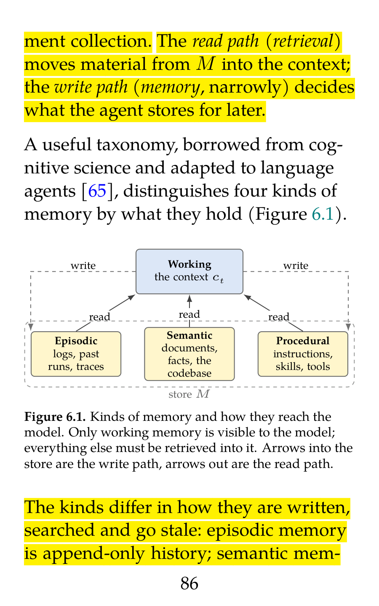
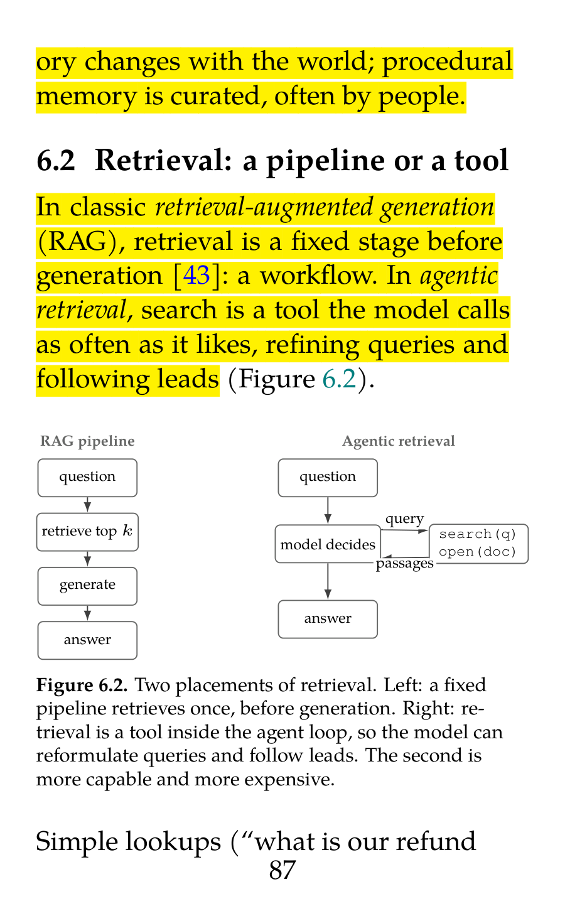
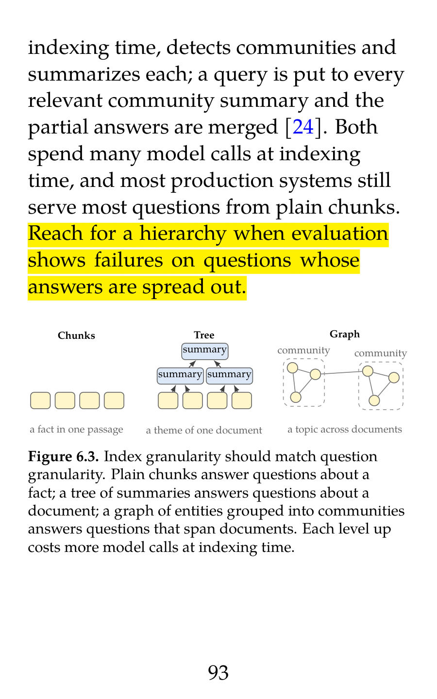

# 第 6 章　窗口之外的知识：检索与记忆

**我们所处的位置。** 我们设计存储 $M$，以及把它接到上下文上的两条路径：读路径（检索）与写路径（记忆）。二者合在一起，让智能体（agent）能使用远超单个窗口容量的信息，并把学到的东西带到后续运行中。

## 6.1 存储及其两条路径

用引用替换内容，前提是有地方存放内容：存储 $M$——目录、数据库、索引或文档集合。读路径（检索）把材料从 $M$ 移入上下文；写路径（狭义的记忆）决定智能体为日后存下什么。

一种有用的分类法借自认知科学，并适配到语言智能体 [65]，按所保存的内容区分四种记忆（图 6.1）。

*图 6.1. 记忆的种类及其如何到达模型。只有工作记忆对模型可见；其余一切都必须检索进工作记忆。指向存储的箭头是写路径，离开存储的箭头是读路径。*

各类记忆在如何写入、如何检索以及如何过时上不同：情景记忆是只追加的历史；语义记忆随世界变化；程序记忆常由人工策展。

## 6.2 检索：流水线还是工具

在经典的检索增强生成（RAG）中，检索是生成之前的固定阶段 [43]：一种工作流（workflow）。在智能体式检索（agentic retrieval）中，搜索是模型可随时调用的工具，用于改写查询并追踪线索（图 6.2）。

*图 6.2. 检索的两种安置。左：固定流水线在生成前检索一次。右：检索是智能体循环内的工具，因此模型可以改写查询并追踪线索。后者能力更强，也更昂贵。*

简单查询（「我们的退款窗口是多久？」）适合流水线：更便宜、更快、更易评估。需要追踪引用的问题（「昨晚的构建为什么失败？」）适合智能体式形态。许多编码智能体几乎完全依赖类似 grep 的智能体式搜索，而不用向量索引，因为代码有精确标识符且不断变化。

智能体式检索增加了流水线一次性定死的三个决策：是否检索、发出什么查询，以及结果是否足够、循环是否应继续。每个决策可以落在不同位置。Self-RAG 训练生成器本身发出请求检索的 token，并批判返回内容 [15]。CRAG 不动生成器，插入一个小评估器，把检索到的段落标为正确、模糊或错误，并据此触发改写查询或联网搜索 [78]。Search-R1 用强化学习学习整个循环，唯一奖励是最终答案正确，最终会为每个问题发出若干无人脚本化的改写查询 [33]。在有能力的模型与搜索工具下，三个决策都由策略在循环中做出；各设计的差别在于行为有多少是训练出来的、脚本化的，还是留给模型的，选择应跟评估走。

## 6.3 搜索如何工作

三种排序技术覆盖了大多数实践。

**词法搜索**按与查询词项重叠为文档打分。标准公式 BM25 对查询 $q$ 下的文档 $d$ 打分为

$$
\mathrm{BM25}(d, q) = \sum_{w \in q} \mathrm{idf}(w)\,\frac{f_{wd}(k_1 + 1)}{f_{wd} + k_1 L_d},
$$

其中长度因子 $L_d = 1 - b + b\,|d|/\bar{\ell}$，$f_{wd}$ 是词项在 $d$ 中的频率，$\bar{\ell}$ 是平均文档长度，$\mathrm{idf}(w)$ 随词项稀有度增大，且 $k_1 \approx 1.2$，$b \approx 0.75$ [59]。频率会饱和，长文档会被惩罚。词法搜索擅长精确标识符与错误信息。

**稠密搜索**用嵌入模型把查询与段落映射为向量，训练目标是相关文本向量接近，再按余弦相似度排序，

$$
\mathrm{sim}(q, v) = \frac{q^\top v}{\|q\|\,\|v\|},
$$

并使用近似最近邻索引 [36]。它能捕捉释义（「响应时间」匹配「延迟」），但会错过精确 token。相似度是排序信号，不是真实性证据。

**混合搜索**两者都跑并合并排序。一种简单稳健的合并是倒数排名融合（reciprocal rank fusion）：文档的融合分数为

$$
\mathrm{RRF}(d) = \sum_{r \in \mathrm{rankers}} \frac{1}{k + \mathrm{rank}_r(d)},
$$

其中 $k \approx 60$ [20]；它只用排名，因此不可比的分数无需校准。随后可用重排模型更准确地重排前几十个候选。重排器通常是交叉编码器（cross-encoder）：在一次前向中同时读查询与段落，因此对相关性的判断优于两个分别算出的向量比较（双编码器，bi-encoder），但不能预计算，对整库运行也太慢。分工随之而来：廉价的词法与稠密搜索找候选，昂贵的交叉编码器给几十个候选排序。像 ColBERT 这样的迟交互模型为每个 token 保留一个向量，成本与精度介于两者之间 [37]。

**分块。** 小块能隔离事实，却切断限定；大块浪费预算。按结构边界切分，并考虑在每块前附加一句说明其在文档中位置的句子——Anthropic 报告这显著减少了检索失败 [5]。

**让索引匹配问题。** 一个块能回答关于某个事实的问题。关于整篇文档的问题（「中心主题是什么？」）或关于多篇文档的问题（「这一主题如何被看待？」）没有单一块能回答。两种索引设计应对此问题（图 6.3）。RAPTOR 对块聚类、总结每个簇、嵌入总结并重复，得到一棵树：上层回答主题性问题，叶子回答细节问题；检索搜索所有层级 [61]。GraphRAG 在索引时把实体与关系抽成图，检测社区并总结每个社区；查询被提交给每个相关社区总结，再合并部分答案 [24]。两者在索引时消耗大量模型调用，而多数生产系统仍用普通块服务多数问题。当评估显示答案分散在多处的问题失败时，再采用层次结构。

*图 6.3. 索引粒度应匹配问题粒度。普通块回答关于事实的问题；总结树回答关于文档的问题；按社区分组的实体图回答跨文档的问题。每上一层，索引时的模型调用成本更高。*

## 6.4 单独度量检索

检索失败会伪装成生成失败，因此应单独评估读路径。给定标注的相关段落集合 $R$ 与 top-$k$ 检索集合 $S_k$，

$$
\mathrm{recall}@k = \frac{|R \cap S_k|}{|R|},
$$

$$
\mathrm{MRR} = \mathbb{E}\!\left[\frac{1}{r_1}\right],
$$

其中 $r_1$ 是第一个相关段落的排名。两者都不说明答案是否正确使用了证据（第 10 章）。对智能体式检索，要问轨迹是否曾打开过相关文档。

表 6.1 按出处整理检索增强答案的失败方式。第一组由上述指标捕获；第二组只能靠给答案打分；第三组只能靠阅读轨迹。有一项值得强调。权限泄漏是搜索返回了请求用户本不该看到的段落。访问控制应放在检索器中——在排序前按用户权限过滤，而不是写在给模型的指令里 [79]。

**表 6.1.** 检索增强答案的失败模式，按出处分类。

| 一侧 | 失败 |
|------|------|
| 检索 | 相关段落从未排得够高；索引过时；返回了用户本不该看到的段落（权限泄漏） |
| 阅读器 | 段落在中间被忽略；相似但不相关的段落分散注意；两段矛盾而答案悄悄选了其一 |
| 循环 | 早期错误检索带偏后续每一步；没有停止规则；检索到的文档携带注入指令 |

## 6.5 从段落到有据可依的答案

再举一例：在文档文件夹上问「我们的 API 是否支持批量请求，有什么限制？」为每条检索结果保留出处（稳定标识符、版本、位置）；让模型引用标识符，并由编排层（harness）检查每条是否确实被检索过；再逐条核对主张是否有支持——这需要人工或模型评分器（第 10 章）。检查不是可选项。对生成式搜索引擎的审计发现，用户觉得答案流畅有用，但大约只有四分之三的引用真正支撑其所附句子 [46]。模型生成引用的方式，与它生成其他一切的方式一样。

当来源冲突时，用日期与范围说清楚。「我找不到」比「不存在」更诚实。

## 6.6 写路径：记忆

记忆是智能体为其未来的自己写下的东西：偏好（「偏好 pytest」）、项目事实（「集成测试需要 `DB_URL`」）、教训（「CI 使用 Python 3.10」）。三个问题决定它是否有用。

**写什么、何时写。** 写下否则会被重新发现或反复询问的东西，在学到它的时候写。不要重复存储里已有的记录。一条记忆被写下时，其未来价值未知（用户开玩笑说十点前的会「除非有糕点」才有约束力——这可能是也可能不是偏好），因此原始情景日志要与策展后的记忆并存：糟糕的策展决定可以回头修正。

**谁来写。** 三种机制常见。智能体通过记忆工具在判断值得保留时写入，如 MemGPT，模型还管理哪些事实钉在上下文中 [55]。后台进程按自己的节奏阅读对话并添加、更新或删除记忆，把簿记移出智能体上下文 [79]。或者由事件触发写入：上下文接近上限、会话结束。模型驱动的形式更灵活；工作流形式更可预测、更易审计。

**如何读回。** 小记忆装入每个上下文；较大的像任何语料一样被搜索，或通过记忆工具暴露 [55]。仅靠相似度对记忆是弱信号。Generative Agents 把每条记忆打分为近期性、重要性（写入时模型的评分）与对查询相关性的加权和，并发现反思——把近期记忆的更高层总结写回存储——是最关键的成分 [56]。

**如何保持真实。** 存储来源与日期；用更新而非追加矛盾；做整合。整合可在智能体空闲时运行：睡眠时计算（sleep-time compute）在会话之间对已存记忆推理，把关于用户颜色偏好的五条独立陈述合并成一个有序列表，使日后检索直接找到已得出的结论 [44]。把记忆当作不可信输入：在阅读恶意文档时写入的记忆，可把它的指令带进之后每个会话（记忆投毒，第 9 章）。

**权重也是一种记忆。** 模型的权重本身保存事实与程序。对少且会变的事实，上下文胜出：把一个事实微调进去需要成千上万文档，仍会幻觉。对稳定且有环境可练习的程序，训练胜出——这正是提供商如今如何教授智能体行为（第 3 章）。当二者冲突时，上下文通常压过权重，但并不可靠 [79]。

**单独评估记忆。** 记忆基准需要足够长、真正需要记忆的历史，现实的来源与问题，以及可验证的答案；对模拟聊天的选择题只满足最后一点，不满足前两点。在一个跨会话累积约束的 2026 年基准上，带专用记忆存储的系统得分低于简单把一切留在长上下文中的智能体 [79]。最便宜的够用设计往往是长上下文，或智能体用 grep 的文件；对称的失败——过度个性化——也真实存在：急于使用所记内容的模型，用用户饮食的类比回答选举问题。

保存的程序库让能力跨任务累积 [69]；智能体技能是其策展形式。

## 小结

- 存储 $M$ 保存装不进窗口的东西。检索是读路径；记忆是写路径。
- 工作、情景、语义与程序记忆在内容、更新策略与过时方式上不同。
- 检索可以是固定流水线（RAG），也可以是循环中的工具（智能体式检索）。简单查询用流水线；需要追踪线索时用工具。
- 词法搜索找精确词项，稠密搜索找释义；带排名融合的混合搜索二者结合，交叉编码器重排顶部候选。让索引匹配问题：事实用块，主题用树与图。
- 用 $\mathrm{recall}@k$ 与 MRR 单独评估检索，并按侧分类失败：检索、阅读器或循环。访问控制属于检索器。
- 用带出处的段落支撑答案并检查引用；约四分之一生成引用并不支撑其主张。节制地写记忆，带来源与日期，按近期性、重要性与相关性打分，空闲时整合，并当作不可信输入。

## 本章如何衔接

事件日志作为情景记忆，成为第 7 章恢复与第 10 章追踪的基础。检索到的文档与记忆是间接提示注入的主要通道（第 9 章）。子智能体（第 8 章）往往是检索专家。

## 习题

**6.1** 两个排序器把文档排成 $(A, B, C, D)$ 与 $(C, A, D, B)$。用 $k = 60$ 计算 RRF 分数并给出融合顺序。哪个文档因在两个列表顶部附近出现而受益？

**6.2** 运行中智能体读到一份 README，写着「测试前总是先运行 `make setup`」。是否应写入记忆？给出一个赞成与一个反对的理由，并描述若写入应存哪些元数据。
