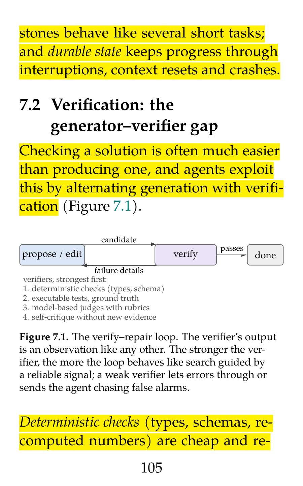
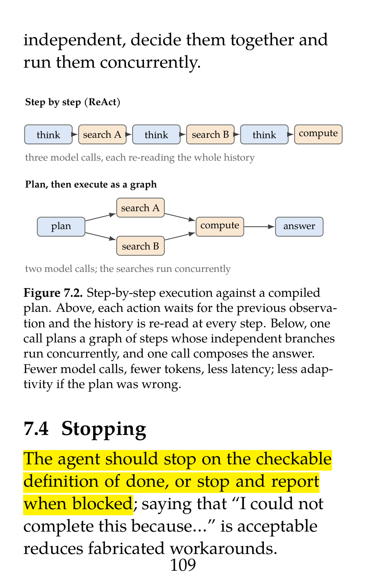
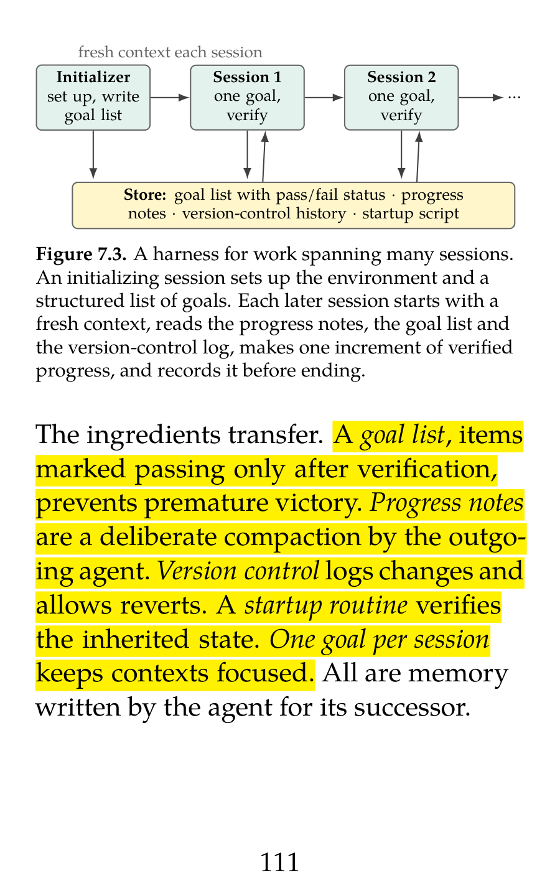
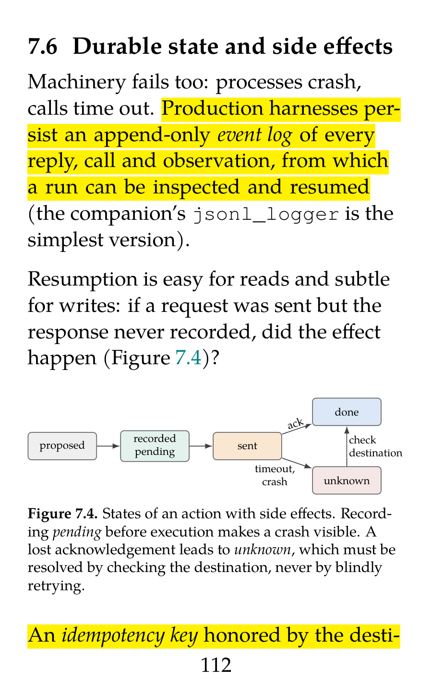

# 第 7 章　控制：验证、规划与长时程

**我们所处的位置。** 我们回到循环本身，面向需要许多步、或超出一个上下文窗口的任务。工具是验证、显式计划、停止规则、进度记录与持久状态。

## 7.1 应对长时程的三种补救

没有反馈时，成功概率按 $r^T$ 衰减。三种补救对抗衰减：验证提高 $d$；分解缩短有效时程，因为经过检查的里程碑行为上像若干短任务；持久状态在中断、上下文重置与崩溃中保住进度。

## 7.2 验证：生成–验证差距

检查一个解往往比产生一个解容易得多，智能体通过交替生成与验证来利用这一点（图 7.1）。

*图 7.1. 验证–修复循环。验证器的输出与其他观察一样。验证器越强，循环越像由可靠信号引导的搜索；弱验证器会放过错误，或让智能体追假警报。*

确定性检查（类型、模式、重算数字）对所检查的内容便宜且可靠。测试检查行为，上限是其覆盖率；这正是编码智能体能工作的原因。模型评判检查程序做不到的事，但必须经过校验（第 10 章）。没有新证据的自我批判最弱；反思在锚定于外部信号（如失败的测试）时帮助最大 [64]。受控试验证实了这一点。在没有新信息的情况下被要求审查并纠正自己的答案时，有能力的模型在算术与常识基准上变得更差 [30]，而能运行代码并搜索的批评者确实改进了它们 [26]。推理模型如今在自身思考中完成大量这类反思，因此在把显式反思步骤加进循环之前，应先度量。

由此得出两条规则。给智能体验证工具并告诉它使用。让「完成」可检查：「让 `test_stats.py` 通过且不修改测试」可被验证与评分；后半句堵住改测试的捷径。

若没有最终产物的验证器，就验证中间产物：每个数字对照计算，每条引用对照检索来源。

## 7.3 规划

有能力的模型隐式规划，对短任务足够。对更长任务，显式计划——智能体维护的工件——把任务分解为可验证的里程碑，让目标在上下文末尾可见，并可在花费一小时之前由人审阅。

待办工具（带状态的步骤，随工作推进更新并展示给用户）简单有效。计划必须可修订；固定计划就是工作流。先规划再执行——在任何工具输出之前固定计划——适应性较差，但有安全收益（第 9 章）。

计划也可以被编译。ReWOO 让模型在执行任何调用之前写出整串工具调用，用占位符（「第 2 步的结果」）连接输出与输入；执行器运行各步而不再调用模型，最后一次调用根据证据合成答案 [77]。LLMCompiler 更进一步：计划是步骤及其依赖的图（有向无环图），独立步骤并行运行，失败检查触发重规划 [40]（图 7.2）。两者在同等或更好准确率下比 ReAct 用更少 token，因为模型不会在每一步重读不断增长的历史。作为动作语言的代码（第 4 章）涵盖了这一想法，因为程序就是带变量的计划，而当前模型在一次回复中发出若干独立工具调用，原因相同。留下来的原则是：当步骤独立时，一起决定并并发运行。

*图 7.2. 逐步执行对照编译后的计划。上：每个动作等待前一观察，历史在每一步被重读。下：一次调用规划出步骤图，独立分支并发运行，一次调用合成答案。更少模型调用、更少 token、更低延迟；若计划错误则适应性较差。*

## 7.4 停止

智能体应在可检查的完成定义上停止，或在受阻时停止并报告；接受「我无法完成，因为……」会减少编造的变通办法。

编排层（harness）强制执行预算，预算由数据设定（成功运行的高分位数）。耗尽的预算有诊断价值：重复相同调用暗示无用的错误或缺失的停止条件；漫游暗示上下文或检索问题。

## 7.5 超出一个上下文窗口

需要数小时与多个上下文窗口的任务，要求新会话能从上次停下处接续。Anthropic 面向长时编码智能体的编排层是清晰模板 [8]（图 7.3）。

*图 7.3. 跨多会话工作的编排层。初始化会话搭建环境并写出结构化目标列表。之后每个会话以全新上下文开始，阅读进度笔记、目标列表与版本控制日志，完成一个经验证的进度增量，记录后再结束。*

这些要素可迁移。目标列表——仅在验证后才标为通过——防止过早宣布胜利。进度笔记是离场智能体有意为之的压缩。版本控制记录变更并允许回退。启动例程验证继承状态。每会话一个目标使上下文保持聚焦。这一切都是智能体为其继任者写下的记忆。

## 7.6 持久状态与副作用

机器也会失败：进程崩溃、调用超时。生产编排层把每次回复、调用与观察持久化为只追加的事件日志，据此可检查并恢复一次运行（配套的 `jsonl_logger` 是最简版本）。

对读操作，恢复容易；对写操作则微妙：若请求已发出但响应从未记录，效果是否发生了（图 7.4）？

*图 7.4. 带副作用的动作状态。执行前记录 pending，使崩溃可见。丢失的确认导致 unknown，必须通过检查目的地来解决，绝不可盲目重试。*

目的地若尊重幂等键，重试无害；否则编排层必须在重试前查询目的地以协调。未确认的外部效果在目的地另有说明之前都是未知的。检查点框架能恢复循环，但不能替你解决这一点。

还有两件机械装置有帮助。有些编排层把历史存成树而非列表：会话可回到更早的点并分支，从而撤销错误转弯而不丢失沿途所学 [79]。来自普通分布式系统的持久执行框架记录每个活动、对失败活动退避重试并保留完整执行历史，越来越多地用于运行智能体步骤；它们把图 7.4 的 pending 记录与重试作为基础设施提供，而非你自己写的代码。

## 小结

- 用验证（提高 $d$）、分解（缩短有效时程）与持久状态（保住进度）对抗复合错误。
- 偏好强验证器：确定性检查与测试优于模型评判，模型评判优于无助的自我批判。让「完成」可检查。
- 显式计划在长任务上有帮助：分解、保持目标可见、可审阅；必须可修订。独立步骤可一起规划并并发运行。
- 在可检查标准上停止，或在受阻时停止；由数据设定预算。
- 多会话工作需要目标列表、进度笔记、版本控制与启动检查。副作用需要 pending 记录以及幂等或协调。

## 本章如何衔接

验证器与评估评分器是同一类对象（第 10 章）；建一个两者都用。分解自然导向把片段委托给其他智能体（第 8 章）。先规划再执行作为注入防御再次出现（第 9 章）。

## 习题

**7.1** 修 bug 的智能体按 `python -m unittest` 是否通过来评分。列出智能体可能不修 bug 却通过的两种方式，并对每种给出任务、工具或评分器上能防止它的改动。

**7.2** 发布工具在发送报告后超时。目的地支持幂等键，但工具每次调用生成新键。若智能体重试会发生什么，键应如何选择？
