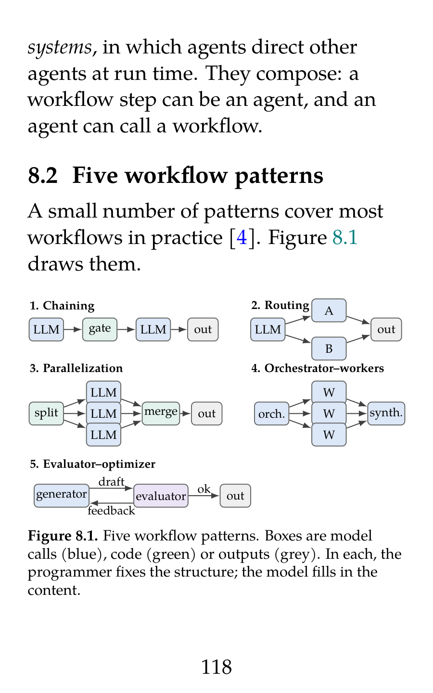
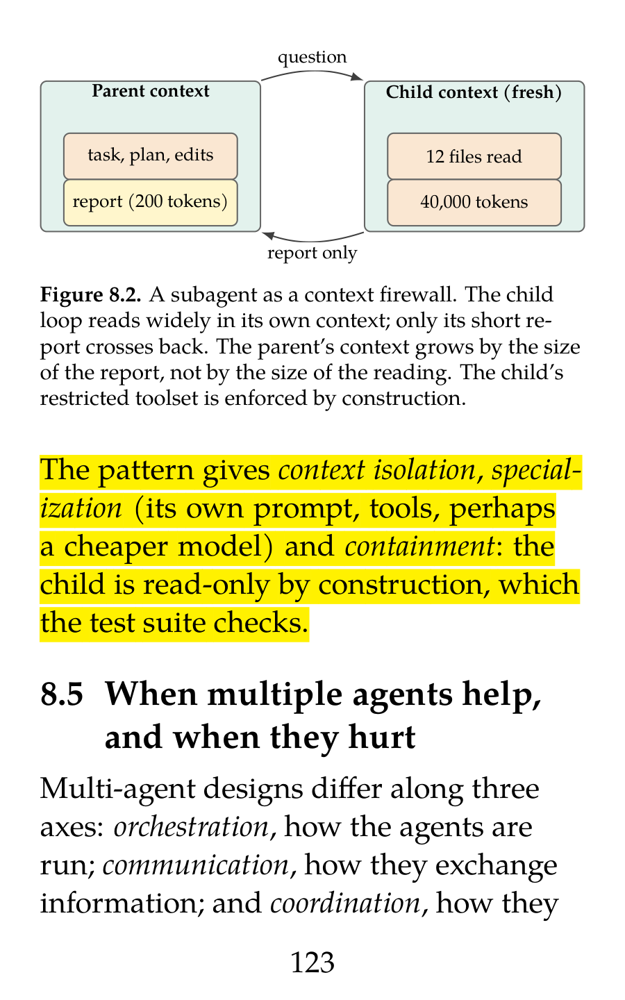
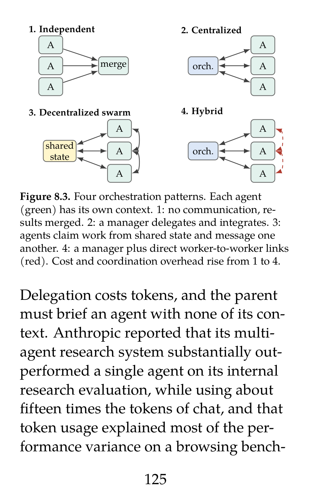
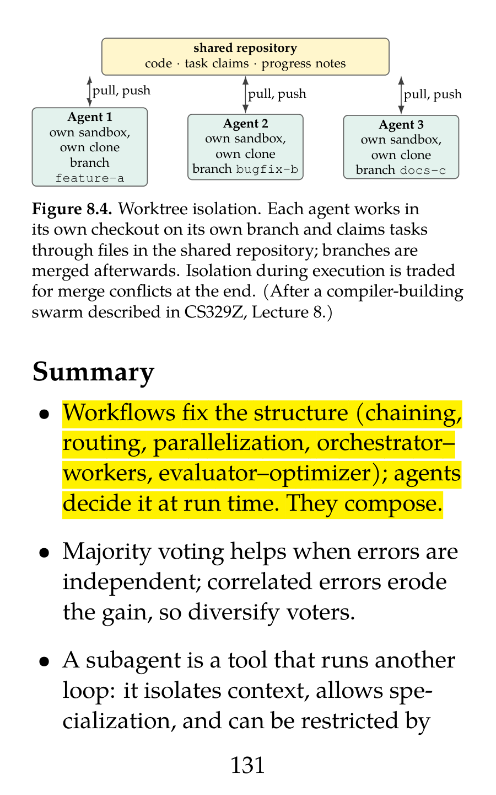

# 第 8 章　组合：工作流与多智能体系统

**我们所处的位置。** 我们改变循环本身的结构：把模型调用链成固定工作流，并让智能体委托给其他智能体。每种模式都是对「谁决定下一步、每部分看到什么？」的不同回答。

## 8.1 固定与动态组合

本章填满第 1 章的谱系：工作流——结构由程序员固定；以及多智能体（multi-agent）系统——智能体在运行时指挥其他智能体。它们可组合：工作流的一步可以是智能体，智能体也可以调用工作流。

## 8.2 五种工作流模式

少数模式覆盖实践中大多数工作流 [4]。图 8.1 画出它们。



*图 8.1. 五种工作流模式。方框是模型调用（蓝）、代码（绿）或输出（灰）。在每一种中，程序员固定结构；模型填充内容。*

**链式（Chaining）** 以固定序列运行调用，中间有程序化检查：提纲、检查覆盖、撰写。

**路由（Routing）** 对输入分类，并派发给带聚焦提示、工具集或模型的专用处理器。常见用途是成本：第一次调用评估问题难度，把简单题送给小模型。

**并行化（Parallelization）** 并排运行独立部分（分段），或对同一任务多次运行再聚合（投票）。分段也让每次调用只关注一件事：安全分类器可与主生成并行，若反对则抑制回复；十条量规可打成十次聚焦调用，延迟等同一次。

**编排者–工作者（Orchestrator–workers）** 让模型在运行时分解任务并综合工作者结果；当工作者是智能体时，即为多智能体系统。

**评估者–优化者（Evaluator–optimizer）** 是第 7 章的验证–修复循环，以模型为验证器；在评估者能可靠区分更好与更差时有效。

## 8.3 投票能买到多少？

投票值得算一笔账，因为其收益容易被高估。假设 $n$ 次运行（$n$ 为奇数）各自以概率 $p > 1/2$ 独立答对。多数正确的概率为

$$
P_{\mathrm{maj}}(n, p) = \sum_{k=(n+1)/2}^{n} \binom{n}{k} p^{k}(1-p)^{n-k},
$$

随 $n$ 增大趋于 1（孔多塞陪审团定理）。当 $p = 0.7$ 时，三票得 $0.784$，五票得 $0.837$，十一票得 $0.922$。自洽性——对采样推理链做多数投票——正是利用这一点 [68]。

关键在于独立性。来自同一模型的样本共享其盲点：误导性段落往往会误导每个样本，完全相关的投票者一无所获。投票帮助特异错误（疏忽），而非系统错误（误解任务）。多样的投票者（不同提示、证据或模型）通常比额外样本更有价值。投票还需要可比较的答案。

多样性必须安排；不会自行出现。被要求讲咖啡笑话时，若干当前模型返回同一笑话；被要求关于时间的隐喻时，多数说河流 [86]。同样的从众出现在智能体之间。一组智能体各自被要求建令人印象深刻的东西时，多数选择光线追踪器或编译器；共享仓库的智能体选择同一分支名 [79]。分配不同视角、证据或模型，比额外样本买到更多。

## 8.4 子智能体就是工具

现在让智能体委托。最简单也最有用的形式不需要新机械装置：子智能体是一个工具，其实现运行另一个智能体循环。

```python
def subagent_tool(model, tools, max_steps=15):
    readonly = [t for t in tools
                if t.effect == "read"]
    def investigate(question: str) -> str:
        res = run(question, model, readonly,
                  max_steps=max_steps,
                  system="Investigate; report "
                         "findings with file:line. "
                         "Do not modify anything.")
        return (res.answer or
                f"(helper stopped: {res.status})")
    return Tool(
        "investigate",
        "Delegate a self-contained question to a "
        "read-only helper with a fresh context. "
        "Returns a short report.",
        {"question": {"type": "string"}},
        investigate)
```

调用 `investigate` 启动一个只有问题与只读工具的全新循环；其简短报告成为父级的观察（图 8.2）。



*图 8.2. 作为上下文防火墙的子智能体。子循环在自己的上下文中广泛阅读；只有其短报告传回。父上下文按报告大小增长，而非按阅读量。子的受限工具集由构造强制。*

该模式提供上下文隔离、特化（自有提示、工具，或许更便宜的模型）与遏制：子级由构造只读，并由测试套件检查。

## 8.5 多智能体何时有益、何时有害

多智能体设计沿三个轴不同：编排——如何运行智能体；通信——如何交换信息；协调——如何分工并避免互相踩踏 [79]。四种编排模式覆盖大多数系统（图 8.3）。独立智能体分别尝试任务，聚合器挑选或合并；这是以智能体为单元的并行化。中心化编排由一个智能体分解、委托并整合，即带持久管理者的编排者–工作者。去中心化蜂群没有管理者：智能体从共享状态（待办列表、任务账本、失败测试集）认领工作并彼此交谈。混合系统保留管理者并让工作者直接通信。成本与协调开销按此顺序上升。



*图 8.3. 四种编排模式。每个智能体（绿）有自己的上下文。1：无通信，结果合并。2：管理者委托并整合。3：智能体从共享状态认领工作并互相发消息。4：管理者加工作者间直接链接（红）。成本与协调开销从 1 到 4 上升。*

委托消耗 token，且父级必须向一个没有任何其上下文的智能体做简报。Anthropic 报告其多智能体研究系统在内部研究评估上显著优于单智能体，同时使用约聊天十五倍的 token，且在浏览基准上 token 用量解释了大部分性能方差 [9]：增益很大一部分是并行计算，对有价值、广度优先的任务划算。

失败模式是冲突的隐式决策：构建同一工件各部分的子智能体做出彼此看不见的选择，部件对不上。Cognition 论证，写代码时带完整上下文的单智能体往往更可靠，拆分工作需要共享上下文与既有决策 [19]。一旦考虑任务结构，这些报告是一致的。

三项后续研究把图景锐化。一项在同一任务上跑单智能体与上述全部四种模式，发现对两个模型家族，带最强模型的单智能体击败所有多智能体安排，对第三个家族则输给去中心化蜂群；按任务看，蜂群在文档繁重的金融任务上获胜，在需要一个连贯上下文的规划任务上惨败 [41]。在编辑触及同一文件的成对编码任务上，一个智能体做两件事通常胜过两个通过聊天协调的智能体，失败也具体：智能体没做它承诺的事、把已宣布的工作当未做、未能传达意图 [39]。从若干多智能体框架轨迹建立的分类法，把近一半失败归给任务规格与编排层设计，三分之一归给智能体间错位，其余归给过早结束任务或检查错误对象的验证 [17]。这些类别是第 10 章错误分析应用到团队上的结果。

**并行化阅读；串行化写入。** 委托那些收集信息且可独立总结的子任务：搜索、文件普查、文献综述。把产生一个连贯工件的任务——如跨代码库的编辑——留给一个智能体、一个上下文。

## 8.6 智能体之间的契约

任务描述是子级的整个世界：陈述目标、输出格式、边界与预算，并要求证据（文件与行、来源 id）。把报告当作观察，在驱动不可逆动作之前先验证。诸如 Agent2Agent（A2A）的协议标准化跨组织委托 [1]；契约与验证仍是设计者的工作。

值得区分两种委托形式（表 8.1）。上面的子智能体是**作为工具的智能体**：父级保持控制，发送特定输入并接收报告。在**交接（handoff）**中，控制本身转移：整段对话移给专家，之后由专家回答用户 [53]。交接适合应拥有后续交互的专家，如计费智能体接管支持对话；工具适合父级将综合结果的有界子任务。

**表 8.1.** 两种委托方式。

| | 作为工具的智能体 | 交接 |
|--|------------------|------|
| 控制 | 留在父级 | 转移给专家 |
| 共享的上下文 | 特定输入 | 整段对话 |
| 用户下一条消息去向 | 父级 | 专家 |
| 典型用途 | 有界子任务 | 交互的其余部分 |

协调需要基础设施。任务账本——带状态与所有者的共享任务列表——让智能体认领工作，让停滞任务被另一个接起；Magentic-One 的编排者在进度账本旁维护一个，记录每一步是否推进 [25]，普通 issue tracker 对编码智能体起同样作用。编辑同一工作副本的智能体会互相干扰，因此各自获得自己的 worktree——自己分支上的独立检出，之后再合并分支（图 8.4）；执行期隔离换来结束时的合并冲突。两者都是编排层级装置：提示告诉智能体检查账本并认领任务，共享仓库强制其余部分。



*图 8.4. Worktree 隔离。每个智能体在自己分支上的自己检出中工作，通过共享仓库中的文件认领任务；之后合并分支。执行期隔离换来结束时的合并冲突。（据 CS329Z 第 8 讲描述的编译器构建蜂群整理。）*

## 小结

- 工作流固定结构（链式、路由、并行化、编排者–工作者、评估者–优化者）；智能体在运行时决定结构。二者可组合。
- 多数投票在错误独立时有帮助；相关错误侵蚀收益，因此要使投票者多样化。
- 子智能体是运行另一循环的工具：隔离上下文、允许特化，并可按构造受限。
- 多智能体系统在编排（独立、中心化、去中心化、混合）、通信与协调上不同，用多得多的 token 换并行广度。强单智能体是要击败的基线。并行化阅读；串行化写入。
- 用显式契约委托并验证回来的内容。有界子任务选作为工具的智能体，专家应拥有交互时选交接；通过任务账本与隔离 worktree 协调。

## 本章如何衔接

子智能体是第 5 章隔离补救的具体化。其受限工具集是最小权限的实例（第 9 章）。多智能体设计是否优于单智能体，是第 10 章方法下的经验问题，成本与质量一并度量。

## 习题

**8.1** 计算 $n = 5$ 个独立投票者、$p = 0.6$ 时的多数投票准确率。再假设以概率 $0.3$ 一个误导性输入使五个投票者一起错，否则他们以 $p = 0.75$ 独立。总体多数准确率是多少？

**8.2** 修 bug 的智能体面对 2,000 个文件的仓库与一个不熟悉模块中的失败。写出它应发给 `investigate` 子智能体的任务描述，包括目标、输出格式、边界与预算。

**8.3** 支持系统有分流智能体、计费专家与技术专家。对下列各项，说明分流智能体应把专家当工具还是交接给它，并说明理由：（a）查发票是否已付；（b）客户想对三笔费用提出争议并讨论退款；（c）检查报告的错误信息是否为已知 bug。
