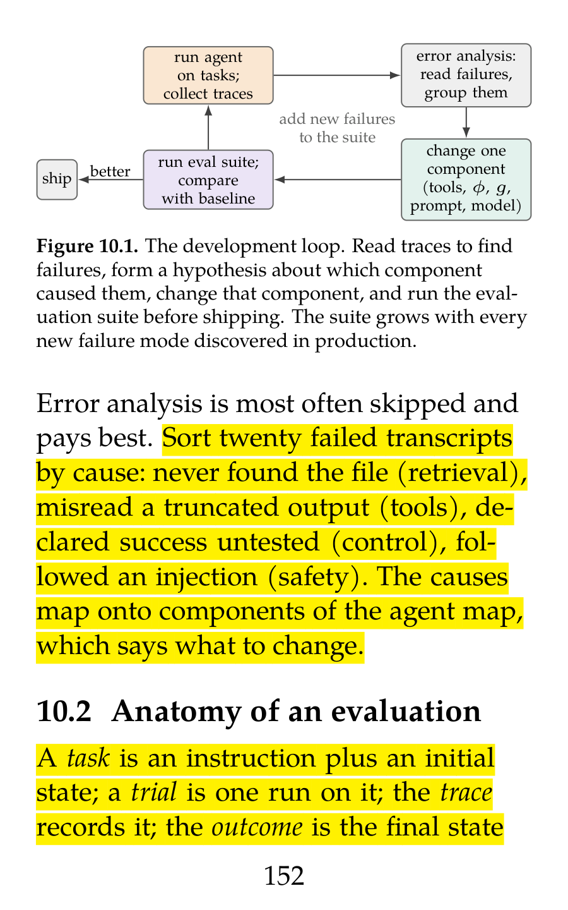
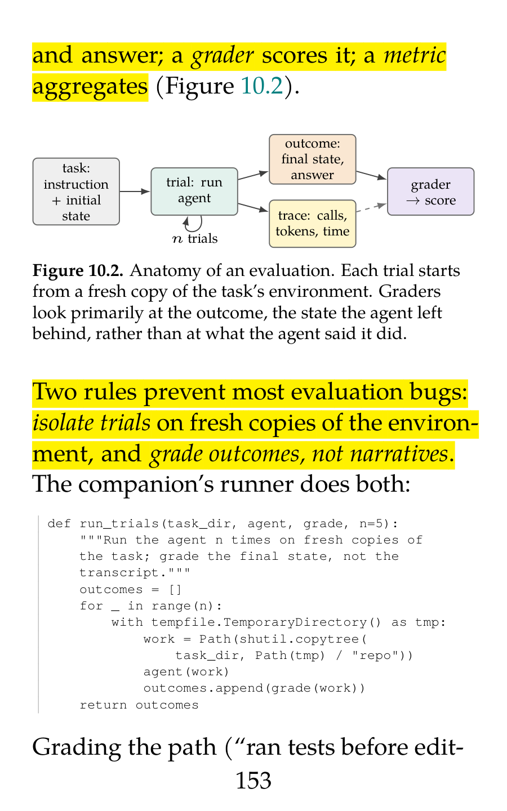
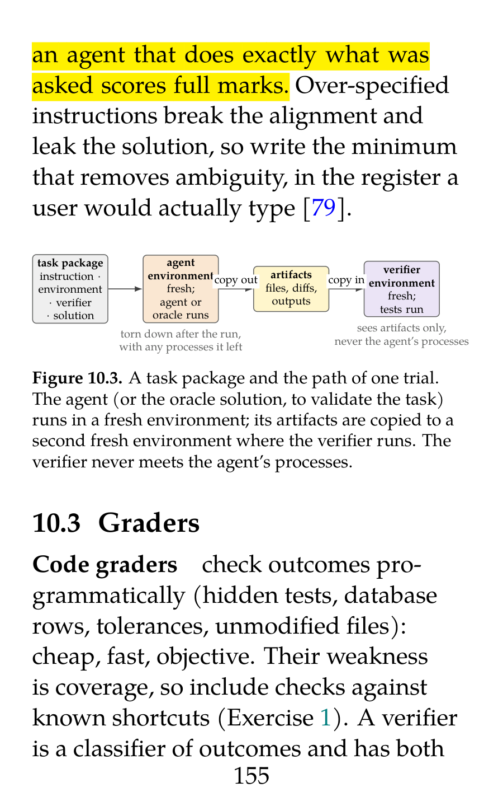
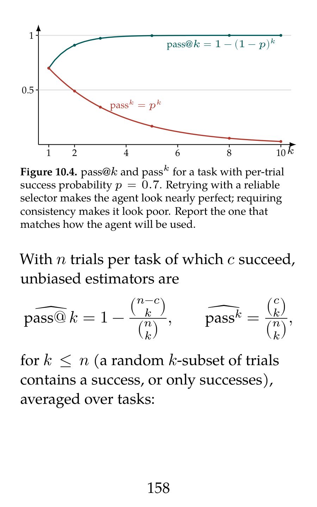
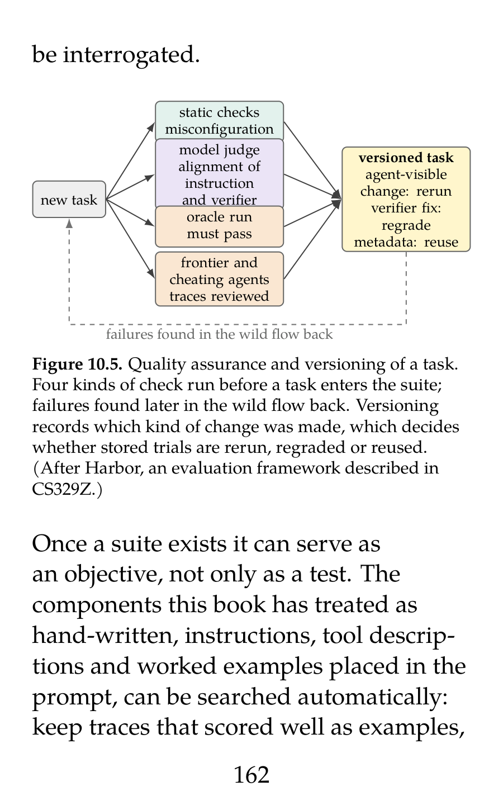

<!-- 原文页码：pp. 150–167（PDF 第 158–175 页） -->
---
title: 第 10 章 评估与可观测性
source: The Little Book of Agent Engineering
pages: 150-167
---

# 第 10 章　评估与可观测性

用户 · 模型 $\pi$ · 存储 $M$（记忆、日志）· 循环控制 · 上下文构建器 $\phi$ · 门控 $g$（权限）· 环境 $E$（工具）· **评估器 $R$** · 编排层 · 任务 · $h_t$ · $c_t$ · $a_t$ · 若允许 · 观测 $o_t$ · 最终状态

**我们在哪里。** 我们构建评估器 $R$ 及其周围的仪表。此前每一章都提出了设计选择；本章提供判定某项选择是否真正有帮助的方法。

## 10.1 评估驱动工程循环

在软件历史的大部分时间里，理解程序靠的是阅读：程序做什么，由其文本决定。步骤由模型选择的程序无法这样阅读；而这类程序写出的代码，实践中又多到读不过来。两者都像学习到的模型一样，从对输入的行为中归纳理解；输出而非源码，成为真相的来源 [79]。这就是本章存在的原因。

智能体行为是随机的，并依赖每一个组件，因此几次运行会误导人：修好一个案例的提示修改，可能弄坏另外三个。可靠的团队收敛到图 10.1 的循环，其中评估套件扮演测试套件的角色 [13]。



图 10.1. 开发循环。阅读轨迹以发现失败，形成关于哪个组件导致失败的假设，改动该组件，并在发布前运行评估套件。套件随生产中发现的每一种新失败模式而增长。

错误分析最常被跳过，却回报最好。把二十份失败转录按原因分类：从未找到文件（检索）、误读被截断的输出（工具）、未经测试就宣称成功（控制）、跟随了注入（安全）。原因对应到智能体地图的组件，从而指明该改什么。

## 10.2 一次评估的解剖

一项**任务**是一条指令加上一个初始状态；一次**试验**是其上的一次运行；**轨迹**记录该运行；**结果**是最终状态与答案；**评分器（grader）**对其打分；**指标**做汇总（图 10.2）。



图 10.2. 一次评估的解剖。每次试验从任务环境的一份全新副本开始。评分器主要看结果——智能体留下的状态——而非智能体自称做了什么。

两条规则可防止多数评估缺陷：在环境的全新副本上隔离试验，以及**对结果打分，而非对叙事打分**。配套代码中的运行器两者都做：

```python
def run_trials(task_dir, agent, grade, n=5):
    """Run the agent n times on fresh copies of
    the task; grade the final state, not the
    transcript."""
    outcomes = []
    for _ in range(n):
        with tempfile.TemporaryDirectory() as tmp:
            work = Path(shutil.copytree(
                task_dir, Path(tmp) / "repo"))
            agent(work)
            outcomes.append(grade(work))
    return outcomes
```

对路径打分（「先跑测试再编辑」）有助于诊断，但会惩罚合法的替代路径；它很少应决定通过或失败。

因此，一项任务是由三部分组成的包：**指令**、**环境**（构建初始状态的脚本或镜像）以及**验证器**——评分器的代码与数据 [13]。第四部分——参考解——对给智能体打分并非必需，却是发现坏任务的最便宜办法：把它当作执行脚本化解法的智能体（**oracle**）来跑，它必须通过，否则验证器或环境有误。评分应在全新环境中运行：把智能体的产物拷出，丢弃其容器及其中残留的进程，再在干净环境中测试（图 10.3）；否则智能体可能留下后台进程或被打补丁的测试运行器，让评分器撞上。最后，指令与验证器必须对齐：指令中的每一条要求对应一项检查，每一项检查对应一条要求，这样恰好按要求完成任务的智能体得满分。过度指定的指令会破坏对齐并泄漏解法，因此只写消除歧义所需的最少内容，并用用户实际会键入的语域来写 [79]。



图 10.3. 任务包与一次试验的路径。智能体（或用于验证任务的 oracle 解）在全新环境中运行；其产物被拷贝到第二个全新环境，验证器在此运行。验证器从不接触智能体的进程。

## 10.3 评分器

**代码评分器**以程序方式检查结果（隐藏测试、数据库行、容差、未修改的文件）：便宜、快速、客观。其弱点是覆盖面，因此要包含针对已知捷径的检查（习题 1）。验证器是结果的分类器，两类错误都有。假阴性——检查拒绝了正确解——与假阳性同样有害，且两者都会随模型变化：更新的模型会发现新捷径，也会发现旧验证器从未预料的合法解。

**模型评分器**把量规应用于代码无法判断的方面，例如忠实性或完整性 [87]。它们偏爱更长的答案、排在前面的选项以及像它们自己的输出，并随其模型漂移。用人工评分样本校准它们；具体标准（「每个数字都引用了来源」）与人类的一致程度远好于整体分数。模型评分器本身也是需要评估的系统：为其构建一小套人工评分案例的基准，并跟踪一致性随时间的变化。

**人类评分器**是参照，也是校准数据的来源；用他们验证评分器并审查样本。

## 10.4 随机智能体的统计

任务 $i$ 上的一次试验是成功概率为 $p_i$ 的伯努利变量；不同问题需要对 $p_i$ 取不同函数。

**pass@$k$ 与 pass$^k$。** 若 $k$ 次尝试中任意一次成功即可（由验证器或人挑选），量是 $1-(1-p_i)^k$；若智能体必须每次都成功，则是 $p_i^k$。这就是 pass@$k$ 与 pass$^k$ [18, 83]。对 $p_i=0.7$，pass@$3=0.973$，而 pass$^3=0.343$（图 10.4）。



图 10.4. 对每试验成功概率 $p=0.7$ 的任务，pass@$k$ 与 pass$^k$。在有可靠选择器的情况下重试，会使智能体看起来近乎完美；要求一致性则使其看起来很差。报告与智能体实际用法相匹配的那一个。

若每任务做 $n$ 次试验其中 $c$ 次成功，无偏估计量为

$$
\widehat{\mathrm{pass@}k}=1-\frac{\binom{n-c}{k}}{\binom{n}{k}},\qquad
\widehat{\mathrm{pass}^k}=\frac{\binom{c}{k}}{\binom{n}{k}},
$$

对 $k\le n$（随机抽取的 $k$ 次试验中含有一次成功，或全是成功），再对任务取平均：

```python
def pass_at_k(n: int, c: int, k: int) -> float:
    """P(some of k trials pass); c of n passed."""
    return 1 - comb(n - c, k) / comb(n, k)

def pass_hat_k(n: int, c: int, k: int) -> float:
    """P(all k trials succeed); c of n passed."""
    return comb(c, k) / comb(n, k)
```

**不确定性。** 有各任务得分 $x_i$ 时，报告 $\bar{x}$ 以及跨任务的标准误 $s/\sqrt{N}$。增加每任务试验次数可降低模型噪声，但无法替代更多任务——任务间差异大得多。

**比较智能体。** 在相同任务上运行两者，并分析差值 $d_i=x_i^B-x_i^A$；配对消除任务变异。对接近比率 $p$ 的非配对二元结果，要使差异 $\Delta$ 等于两个标准误，需要

$$
N\approx\frac{8\,p(1-p)}{\Delta^2},
$$

对 $p=0.7$、$\Delta=0.05$，大约需要 670 个任务。配对有帮助，但小套件只能检出大效应。

## 10.5 构建套件，以及如何阅读基准

从二十到五十个真实任务起步，尤其是已观察到的失败，每项带有无歧义的标准 [13]。保留**能力任务**（进展）与**回归任务**（防护）；纳入同时对成功与安全打分的对抗案例；留出一部分任务以防过拟合。

准确率只是质量的一个维度。**一致性**问重复运行是否达到相同结果，由 pass$^k$ 度量；**鲁棒性**问对任务的一次小而无关的扰动如何改变结果；**可预测性**问失败是否可读、可恢复。一份在所有这些维度上给智能体打分的排行榜发现，准确率排名与可靠性排名无关 [35]。最能干的智能体并非最可靠的那个，因此套件应包含任务的扰动变体，并在准确率旁报告一致性。

任务是软件，也有 bug。在信任一套件之前，让每项任务经过质量检查（图 10.5）[79]：针对错误配置的静态检查；把指令中每条要求映射到验证器中一项检查的模型评判；必须通过的 oracle 解；前沿智能体（当前最强模型），其轨迹显示任务是因预期原因而难，还是因为某个包坏了；以及被指示去作弊的智能体，它会找到评分器漏掉的捷径。然后对任务做版本管理。对验证器的修复意味着对已存储试验重新打分而无需重跑智能体；对参考解的修复完全不需要重跑；智能体能看见的任何改动——指令、环境或工具——都会使过往试验失效。保留每次试验的轨迹，而不只是分数：套件教给你的大部分内容都在轨迹里，没有试验的已发表数字无法被追问。



图 10.5. 任务的质量保证与版本管理。四类检查在任务进入套件前运行；之后在野外发现的失败回流回来。版本管理记录所做改动的种类，从而决定已存储试验是重跑、重评分还是复用。（依据 Harbor——CS329Z 中描述的评估框架。）

一旦套件存在，它不仅可以当测试，还可以当目标。本书此前当作手写处理的组件——指令、工具描述、放入提示的示例——可以自动搜索：保留得分高的轨迹作示例，让模型阅读失败轨迹并提出改写后的指令，仅当留出集有改进时才接受候选 [38, 3]。纪律正是评估已要求的那一套——分开训练、开发与测试任务——而风险也是评分器已有的那种：提示去钻弱指标的空子。自动优化使好套件更有价值，使坏套件更危险。

公开基准有助于选择模型：SWE-bench（真实 GitHub issue）[32]、$\tau$-bench（工具使用与一致性）[83]、Terminal-Bench、OSWorld 与 GAIA [67, 76, 51]。METR 度量智能体以 50% 概率完成的任务的人类时间长度——这一视野在 2019–2025 年间大约每七个月翻一番，在最近的更新中更快 [42]。注意：结果依赖编排层；基准会泄漏并饱和；不含成本的准确率是不完整的 [34]。

## 10.6 可观测性

部署之后，仪表就是轨迹：一次运行的 span 树，每一次模型调用（词元、延迟、停止原因）与每一次工具调用（参数、结果、时长）。OpenTelemetry 的生成式 AI 约定让同一工具链可从任意框架收集轨迹 [54]。轨迹产出运行指标：成功代理量、成本、延迟与每任务步数、工具错误、批准次数。

仪表盘做汇总；转录做解释。定期阅读失败与成功样本：没有任何聚合会告诉你，智能体已经开始删除失败的测试。每一份令人惊讶的转录，都是套件的候选。

## 小结

- 评估是智能体的测试套件：对工具、上下文、策略、提示或模型的每一次改动都要运行。
- 任务是指令加初始状态；隔离试验，并对结果而非叙事打分。
- 优先使用代码评分器；用人类判断校准模型评分器；用人类作参照与审查。
- pass@$k$ 与 pass$^k$ 回答不同问题，并迅速分叉。报告不确定性，在配对任务上比较智能体，并记住小套件只能检出大效应。
- 任务是指令、环境与验证器，一一对齐，并有参考解证明任务本身可用。在全新环境中评分。
- 从真实失败构建套件，纳入对抗与扰动案例，留出任务，检查并为每项任务做版本管理。带着成本与编排层意识阅读基准。
- 追踪每一次调用；阅读转录；保留每一次试验。可信的套件随后可驱动提示与工具描述的自动优化。

## 本章如何衔接

评分器是用于度量而非修复的验证器（第 7 章）。错误分析把失败归因到第 4–9 章的组件。第 11 章把各部分放在一起，并给出审查智能体设计的清单。

## 习题

**10.1** 智能体在某任务上运行 $n=5$ 次试验，成功 $c=3$ 次。计算 $\widehat{\mathrm{pass@}3}$ 与 $\widehat{\mathrm{pass}^3}$。对于提出一个修复、再由人接受或拒绝的代码审查助手，你会报告哪一个？

**10.2** 智能体 B 在 100 任务套件上以四点优势击败智能体 A（72% 对 68%），每任务一次试验，非配对。该差异在大约两个标准误的意义上能否与噪声区分？你会如何改变实验？

**10.3** 套件已运行（每任务五次试验，轨迹已存）后，提出三项改动：(a) 因智能体通过对样本输入做特例处理而通过，给任务增加一项隐藏测试；(b) 因任务指令泄漏了 bug 位置而缩短指令；(c) 因参考解已不再通过而修复它。对每一项，说明哪些已存储结果仍然有效、必须重做什么，以及为什么。
