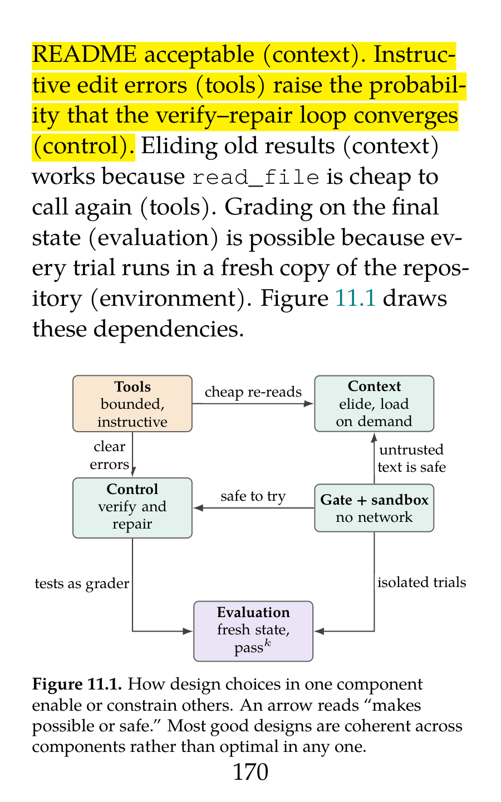

<!-- 原文页码：pp. 168–177（PDF 第 176–185 页） -->
---
title: 第 11 章 汇总
source: The Little Book of Agent Engineering
pages: 168-177
---

# 第 11 章　汇总

用户 · 模型 $\pi$ · 存储 $M$（记忆、日志）· 循环控制 · 上下文构建器 $\phi$ · 门控 $g$（权限）· 环境 $E$（工具）· 评估器 $R$ · 编排层 · 任务 · $h_t$ · $c_t$ · $a_t$ · 若允许 · 观测 $o_t$ · 最终状态

**我们在哪里。** 每一个组件现已设计完毕。本章把它们作为同一系统来回顾，给出设计评审清单，并以长期运营智能体作结。

## 11.1 贯穿示例，组装完毕

表 11.1 汇总修 bug 智能体的设计，每个组件一行。其中大部分与模型无关。

表 11.1. 修 bug 智能体，按组件逐项。

| 组件 | 决策 | 章 |
|------|------|----|
| 架构 | 单一智能体；路径未知，测试验证，编辑可逆 | 1 |
| 模型 $\pi$ | 适配器后的能力模型；编排层测试用脚本化模型 | 2 |
| 循环 | 最小循环；在无工具调用、截断或预算耗尽时停止 | 3 |
| 动作 $\mathcal{A}$ | 五个工具；以唯一替换做编辑；声明效果 | 4 |
| 上下文 $\phi$ | 稳定前缀；省略旧工具结果；项目简报文件 | 5 |
| 存储 $M$ | 带 search 的智能体式搜索；事件日志；无需记忆 | 6 |
| 控制 | 「测试前后都要跑」；完成 = 测试通过且测试未改 | 7 |
| 组合 | 可选的只读调查子智能体，用于大型仓库 | 8 |
| 门控 $g$ | 读自由；编辑与测试运行需批准或沙箱；无网络 | 9 |
| 评估器 $R$ | 对最终状态的隐藏测试；每任务 $n$ 次试验；pass$^k$ | 10 |

各行并非彼此独立。决定没有网络工具（门控），才使阅读不可信 README 可以接受（上下文）。具有指导性的编辑错误（工具）提高验证–修复循环收敛的概率（控制）。省略旧结果（上下文）之所以可行，是因为再次调用 `read_file` 很便宜（工具）。对最终状态打分（评估）之所以可能，是因为每次试验都在仓库的全新副本中运行（环境）。图 11.1 画出这些依赖。

图 11.1. 一个组件中的设计选择如何使其他组件成为可能或受其约束。箭头读作「使……成为可能或安全」。多数好设计是跨组件连贯的，而不是在任一组件上局部最优。

## 11.2 设计评审清单

下面的清单沿智能体地图展开。它用于在构建前审查设计，也用于诊断表现不佳的系统。

**架构（第 1 章）。** 是否必须用智能体，还是工作流就够？成功是否可验证？错误的代价是什么，能否撤销？

**模型（第 2 章）。** 用哪个模型、何种努力级别，如何选定？提供方是否在适配器之后？除「完成」以外的停止原因是否得到处理？

**循环（第 3 章）。** 预算是什么（步数、词元、时间、金钱）？所有工具失败是否都变成观测？是否区分「已作答」与「已成功」？

**工具（第 4 章）。** 每个工具是否必要且彼此有别？输出是否服务于下一步决策，且是否有界？错误是否有指导性？每个工具的效果类别是否已声明？

**上下文（第 5 章）。** 模型在第 1 步与第 50 步看见什么？前缀是否为缓存而稳定？增长如何控制，信息移除是否可恢复？

**检索与记忆（第 6 章）。** 智能体如何找到所需内容？检索质量是否单独度量？写入记忆的是什么、带何种出处、如何纠正？

**控制（第 7 章）。** 什么验证进展？「完成」是否可检查？工作能否在上下文重置或崩溃后存活？外部效果是否幂等或可对账？

**组合（第 8 章）。** 若使用多个智能体，各自看见什么；一个上下文更好的单一智能体能否以更低成本做得同样好？

**安全与安保（第 9 章）。** 致命三要素的哪些腿存在？门控在不问的情况下允许什么？什么限制已执行代码的效果？批准是否针对确切动作？

**评估（第 10 章）。** 是否有套件，由真实任务与失败构成，并使用基于结果的评分器？是否包含对抗案例？结果是否连同不确定性、成本以及与用法匹配的指标一并报告？

## 11.3 长期运营智能体

其最重要的组件由别人按别人的时间表提供。

**版本化整个配置：** 模型与设置、提示、工具、上下文与门控策略、编排层代码。一次只改一个元素，评估每一次改动，并用版本标记轨迹。

**渐进推出，** 观察成本、延迟、步数与工具错误——它们往往先于成功率变动。

**从事故中学习：** 保留轨迹，找到允许失败发生的组件，修复它，把案例加入套件。回滚改变的是未来行为，而非已经造成的效果。

**在模型变化时重访编排层。** 为较弱模型搭的脚手架可能拖累较强模型；每次升级都是一次去掉结构、让套件裁决的机会 [14]。编排层应随时间变简，而不只是变大。关系是双向的。最强模型在最简编排层上表现最好，而更便宜或开权模型（权重已公开）可能需要强模型不再需要的结构；更好编排层中的更便宜模型也可能是经济之选 [79]。哪一对搭配取胜是一项度量，而非口号。

## 11.4 下一步去哪里

实践中你可能使用现成的编排层：带内置工具、上下文管理、权限与子智能体的提供方智能体 SDK；带检查点的基于图的工作流框架；运行循环与沙箱的托管服务。智能体地图适用于所有这些：问清每个产品为每个组件做了什么、以及在何处允许你插入。表 11.2 展示三个开源编码编排层如何以不同方式回答这些问题——内部是同一模型 [79]。

表 11.2. 三个开源编码编排层及其设计选择（截至 2026 年末的描述）。每一个都是对第 4、5、9 章问题的不同回答。

| | mini-SWE-agent | OpenHands | Pi |
|--|----------------|-----------|-----|
| 工具 | 仅 shell | shell、编辑器、浏览器 | 默认 read、write、edit、shell |
| 上下文 | 线性历史，全部追加 | 事件流，从事件重建上下文 | 带分支与回滚的树 |
| shell | 每条命令新进程 | 持久终端 | 工作会话 |
| 门控 | 无；在沙箱中运行 | 可配置 | 无；以其进程身份运行 |

进一步阅读方面，全书引用的工程文章——尤其是关于构建有效智能体 [4]、编写工具 [11]、上下文工程 [7]、长时运行编排层 [8] 与评估 [13] 的——篇幅短且实用。研究基础可从 ReAct [82]、SWE-agent [80] 与 CoALA 框架 [65] 入手；安保方面，见设计模式论文 [16] 与 CaMeL [22]。

该领域变化很快，书中具体产品与数字会过时。结构不应过时：一个随机策略，一个决定它看见什么、可以做什么的编排层，一个作出回应的环境，以及告诉我们整体是否在变好的度量。
